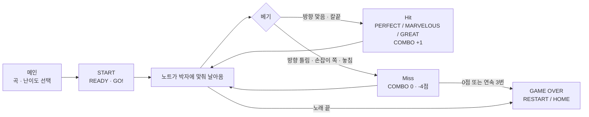

# 01. 게임 컨셉 제안서 — VR BeatSync

> 문서 세트: [목차](Proposal.md) · **01 컨셉** · [02 시스템](02_System.md) · [03 베기·개체](03_Combat_Entity.md) · [04 레벨 디자인](04_LevelDesign.md) · [05 밸런스](05_Balance.md) · [시뮬레이션](Simulation.html)

---

## 한 줄 정의 (Elevator Pitch)
> **음악에 맞춰 날아오는 노트를 양손의 빛나는 칼로 베며, 칼끝으로 정확히 벨수록 높은 판정을 받는 VR 리듬 액션.**

| 항목 | 내용 |
|---|---|
| 장르 | VR 리듬 액션 (운동 + 리듬) |
| 플랫폼 | 6DoF VR 헤드셋 |
| 엔진 | Unity 6 · XR Interaction Toolkit · URP |
| 플레이 시간 | 곡당 1 ~ 3분 (수록곡 3곡) |
| 타깃 유저 | 리듬 게임 유저, 가볍게 몸을 움직이고 싶은 VR 유저 |

## 핵심 재미 (Core Fun)
| 키워드 | 무엇이 재미있나 | 코드 근거 |
|---|---|---|
| **박자감** | 랜덤이 아니라 **실제 노래의 악보(Beat Sage 비트맵)**대로 노트가 옴 | `BeatmapParser`, `NoteScheduler` |
| **방향 베기** | 화살표 방향으로 휘둘러야 잘림 → 몸 전체를 쓰는 동작 | `Saber` (130도 판정) |
| **칼끝 판정** | 칼의 어느 부분에 맞았는지로 GREAT / MARVELOUS / PERFECT | `HitZone` |
| **콤보 보상** | 첫 Hit +5, 연속 Hit +7 → 콤보를 지킬 이유 | `ScoreSystem` |
| **몰입 연출** | 레인보우 칼 트레일 · 180도 배경 영상 · 판정 팝업 | `RainbowTrailFollower`, `EffectManager` |

## 코어 루프


| 루프 | 주기 | 현재 | 💡 제안 |
|---|---|---|---|
| 순간 루프 | 0.2 ~ 1초 | 노트 확인 → 베기 → 판정 | 판정별 점수 차등 |
| 세션 루프 | 1 ~ 3분 | 곡 플레이 → GAME OVER | 곡 완주 시 결과 화면 · 랭크(S/A/B) |
| 장기 루프 | 여러 판 | 없음 | 곡 · 난이도별 최고 점수, 새 곡 해금 |

## 레퍼런스 대비 차별점
| 레퍼런스 (장르) | 가져온 점 | BeatSync의 차이 |
|---|---|---|
| VR 리듬 베기 장르 대표작 | 양손 칼 · 색 · 방향 노트, 비트맵 형식 | **칼의 어느 부분에 맞았는지**로 판정 (타이밍 + 정확도) |
| 음악 게임 (키 입력형) | 판정 문구 · 콤보 · 점수 | 손이 아닌 **몸 동작**이 입력 |
| AI 비트맵 생성 도구 | 아무 노래나 악보로 만들기 | 곡 추가가 쉬움 (JSON만 넣으면 됨) |

## VR 공간 구성
```
      ┌─────────── 180도 배경 영상 ───────────┐
                 노트 생성 지점
                 ▣ ▣   ▣ ▣     ← 줄 2개 × 층 3개 (빨강 · 파랑)
                   ↓ 다가옴 (속도 3 / 5 / 8)
      SCORE · COMBO · MISS · LEVEL
                 🗡️  🥽  🗡️     ← 왼손 빨강 칼 · 오른손 파랑 칼 (길이 2m)
```

## 개발 현황
| 구분 | 상태 |
|---|---|
| 구현 완료 | 비트맵 파싱 · 시간 맞춤 노트 생성 · 음악 예약 재생 · 카운트다운 · 칼 판정 3단계 · 방향 판정 · 점수 · 콤보 · 레벨 · GAME OVER 3조건 · 곡 / 난이도 선택 · 연출 |
| 구조 | 인터페이스 13개로 역할 분리, `InterfaceReference`로 인스펙터에서 연결 (구체 클래스에 의존하지 않음) |
| 다음 목표 | 결과 화면 · 첫 노트 보호 · 난이도 차별화 · 판정별 점수 |
