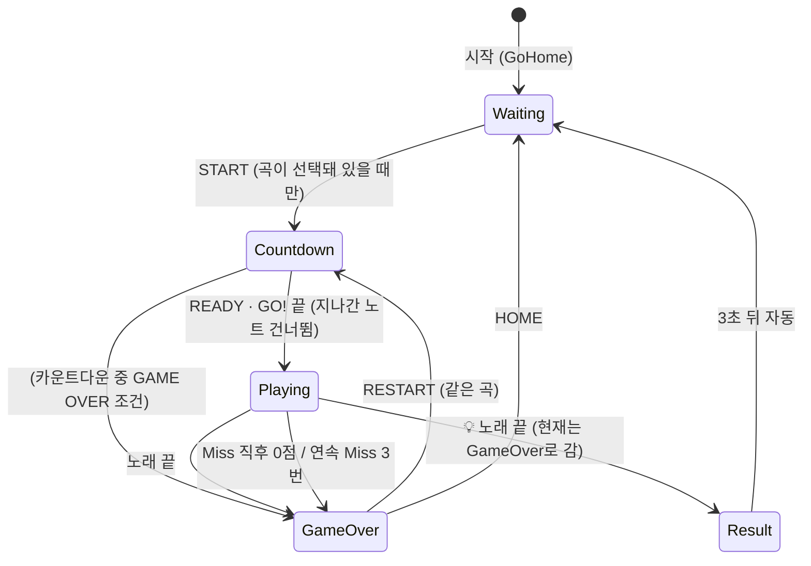

# 02. 시스템 기획서 — 게임 흐름 · 노트 생성 · 판정 · 점수

> 문서 세트: [목차](Proposal.md) · [01 컨셉](01_Concept.md) · **02 시스템** · [03 베기·개체](03_Combat_Entity.md) · [04 레벨 디자인](04_LevelDesign.md) · [05 밸런스](05_Balance.md)
> 관련 코드: `GM.cs` · `MusicPlayer.cs` · `BeatmapParser.cs` · `LaneMapper.cs` · `NoteScheduler.cs` · `NoteSpawner.cs` · `Note.cs` · `Saber.cs` · `HitZone.cs` · `ScoreSystem.cs`

---

## 1. 게임 상태 머신 (`GM`)


| 상태 | 음악 | 노트 | 화면 |
|---|---|---|---|
| Waiting | 정지 | 모두 제거 | 곡 · 난이도 선택, START |
| Countdown | 재생 시작 | 생성 안 함 | READY → GO! (1초씩) |
| Playing | 재생 | 악보 시간대로 생성 | SCORE · COMBO · MISS · LEVEL |
| GameOver | 정지 (GAME OVER일 때) | 생성 중단 · 모두 제거 | 이번 판 최고 점수 · LEVEL · RESTART · HOME |

## 2. 작동 로직
### 2-1. 게임 시작 `PlayRoutine()`
```
START
├─ IF 상태 ≠ Waiting OR 곡 선택 안 됨 → 무시
└─ ELSE
    ├─ 남은 노트 제거 · 점수 초기화
    ├─ 난이도 → 악보 레벨(Normal / Hard / Expert) 선택 (없으면 Expert)
    ├─ 악보 JSON 읽기: 박(beat) × 60 ÷ BPM = 초, 빨강 · 파랑만(폭탄 제외), 시간순 정렬
    ├─ 노트 속도 = 난이도 속도, 줄 수 = 난이도 줄 수 → LaneMapper로 줄 합치기
    ├─ 이동 거리 = 생성 지점 → 플레이어 거리, 이동 시간 = 거리 ÷ 속도
    ├─ 음악 예약 재생 (지금 + 0.1초, 오디오 시계 기준)
    ├─ 카운트다운 (READY · GO! 각 1초)
    ├─ 카운트다운 동안 생성 시간이 지난 노트는 건너뜀
    └─ Playing
```

### 2-2. 노트 생성 `NoteScheduler.Tick()`
```
매 프레임 (Playing)
├─ IF 노래 끝 → GAME OVER 상태로 종료
└─ 곡 시간 = 오디오 시계 - 시작 시각 + 보정값
    └─ WHILE 다음 노트의 생성 시간(= 노트 시간 - 이동 시간) ≤ 곡 시간
        ├─ 늦은 만큼 앞에서 생성 (프레임 지연 보정: (곡 시간 - 생성 시간) × 속도)
        ├─ 위치 = 줄(가로 0.6m 간격) · 층(세로 0.5m 간격), 화살표 방향으로 회전
        └─ 판정 결과를 점수 시스템에 연결
```
> 핵심 설계: 노트가 플레이어에 닿는 순간 = 음악 속 그 박자. 프레임 시간이 아니라 **오디오 시계(dspTime)**로 맞춰서 프레임이 떨어져도 박자가 밀리지 않음.

### 2-3. 베기 판정 (`Saber` → `HitZone` → `Note`)
```
매 프레임 (칼마다)
├─ 손 위치에서 칼 방향으로 2m 레이캐스트 (노트 레이어만)
├─ IF 노트에 닿음
│   ├─ 칼 속도 = 이번 프레임 이동 거리 ÷ 시간
│   ├─ IF 속도 < 0.5 m/s → 판정 안 함 (칼을 대고만 있음)
│   └─ ELSE
│       ├─ 방향 = 휘두른 방향과 노트 위쪽이 130도 넘게 차이 나는가
│       ├─ IF 방향 틀림 → MISS
│       └─ ELSE → 맞은 거리로 판정
│           ├─ 0 ~ 1.0m → MISS (손잡이 쪽)
│           ├─ 1.0 ~ 1.2m → GREAT
│           ├─ 1.2 ~ 1.5m → MARVELOUS
│           └─ 1.5 ~ 2.0m → PERFECT
│       └─ 노트.Cut(판정) → 한 번만 판정되고 사라짐
└─ 노트가 플레이어를 1m 지나도록 안 베임 → MISS
```

### 2-4. 점수 `ScoreSystem.Register()`
```
IF 이미 GAME OVER → 무시
IF Hit  → COMBO +1, 연속 Miss 0, 점수 += (COMBO ≥ 2 ? 7 : 5)
IF Miss → COMBO 0, MISS +1, 연속 Miss +1, 점수 = max(0, 점수 - 4)
이번 판 최고 점수 갱신
WHILE 점수 ≥ 다음 레벨 점수 → LEVEL +1, 다음 레벨 점수 × 2 (200 → 400 → 800 …)
IF Miss AND (점수 ≤ 0 OR 연속 Miss ≥ 3) → GAME OVER 알림 → GM이 노트 제거 · 음악 정지
```

## 3. 예외 처리 (Edge Case)
> ✅ 처리됨 · ⚠️ 문제 · 💡 제안

| # | 상황 | 현재 동작 | 상태 | 처리 방안 |
|---|---|---|---|---|
| 1 | **첫 노트를 놓침** | 0점에서 Miss → 점수 0 → 즉시 GAME OVER | ⚠️ | 💡 첫 Hit 전에는 조건 ② 제외, 또는 시작 점수 20 |
| 2 | **노래를 끝까지 완주** | GAME OVER 상태로 끝남 (같은 패널) → 클리어인지 실패인지 구분 없음 | ⚠️ | 💡 `Result` 상태로 보내 "CLEAR!" + 랭크, 이미 있는 3초 자동 복귀 활용 |
| 3 | **카운트다운 중 지나간 노트** | 생성 시간이 지난 노트는 건너뜀 → 곡마다 최소 0 ~ 4개 사라짐 (느린 난이도일수록 더 많음) | ⚠️ | 💡 카운트다운이 끝난 뒤 노래 재생 (또는 첫 노트 2초 전부터 시작) |
| 4 | 프레임이 늦어 노트가 늦게 생성 | 늦은 만큼 앞에서 생성 | ✅ | – |
| 5 | 한 노트에 칼이 여러 프레임 닿음 | `_isJudged`로 1번만 | ✅ | – |
| 6 | 칼을 노트에 대고만 있음 | 0.5m/s 미만이면 판정 안 함 | ✅ | – |
| 7 | **칼이 노트를 지나가며 손잡이 쪽이 먼저 닿음** | 레이가 처음 닿은 지점이 0 ~ 1m면 즉시 MISS → 칼끝으로 벨 생각이었어도 실패 | ⚠️ | 💡 한 번의 휘두르기 동안 가장 먼 거리를 기준으로 판정 (휘두르기 끝에 확정) |
| 8 | 방향 "아무 방향(Any)" 노트 | 아래로 베기로 처리 → 다른 방향으로 베면 MISS | ⚠️ | 💡 Any는 방향 검사 생략 |
| 9 | 폭탄 노트(type 3) | 읽을 때 제외 | ✅ | 💡 피해야 하는 장애물로 추가 |
| 10 | 2줄로 합칠 때 같은 시간 · 줄 · 층에 노트가 겹침 | 하나만 남김 | ✅ | – |
| 11 | 줄 수 3 | `LaneMapper`가 4 미만이면 무조건 2줄로 → 3은 2와 같음 | 💡 | 3줄 매핑 추가 또는 범위를 2 / 4로 |
| 12 | 곡을 선택하지 않고 START | 무시 | ✅ | – |
| 13 | GAME OVER 후 RESTART | 같은 곡 · 난이도로 처음부터, 점수 0 | ✅ | – |
| 14 | 헤드셋을 벗음 | 처리 없음 → 노래 · 노트 계속 | 💡 | 일시정지 + 노래 일시정지 (오디오 시계 보정 필요) |
