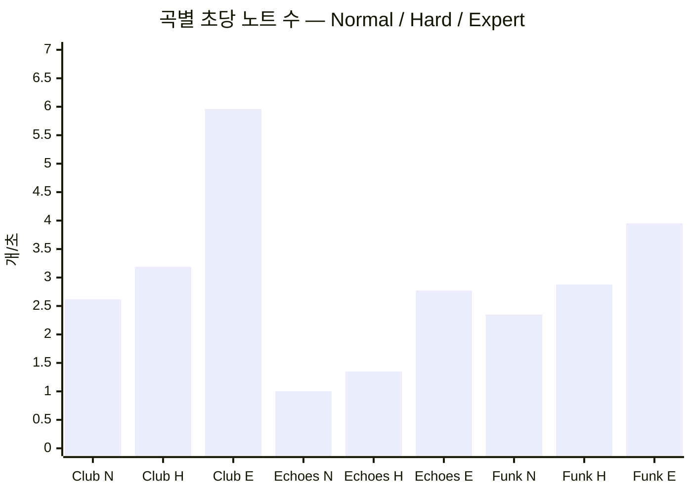

# 04. 레벨 디자인 기획서 — 노트 배치 · 곡 · 난이도

> 문서 세트: [목차](Proposal.md) · [01 컨셉](01_Concept.md) · [02 시스템](02_System.md) · [03 베기·개체](03_Combat_Entity.md) · **04 레벨 디자인** · [05 밸런스](05_Balance.md)
> 데이터: [`05_Balance/beatmap_stats.csv`](05_Balance/beatmap_stats.csv) — 실제 비트맵 JSON 9개를 읽어 계산

---

## 1. 콘셉트
리듬 게임의 "레벨" = **곡 × 난이도 악보**. 맵 대신 **노트가 어디에, 얼마나 촘촘히, 어떤 방향으로** 오는지가 레벨 디자인이에요.

| 항목 | 내용 |
|---|---|
| 악보 출처 | Beat Sage(AI 비트맵 생성)로 만든 `.dat` → `.json` |
| 곡 | Club Change Up · Echoes of Lumen · Upbeat Funk (모두 BPM 120) |
| 난이도 | Normal · Hard · Expert = 곡마다 악보 3개 + 노트 속도 3 / 5 / 8 |

## 2. 노트 배치 그리드
**원본 악보:** 가로 4줄(lineIndex 0 ~ 3) × 세로 3층(lineLayer 0 ~ 2) = 12칸
**현재 게임:** `LaneMapper`가 가로 4줄을 **2줄로 합침** (0 · 1 → 왼쪽, 2 · 3 → 오른쪽), 겹치는 노트는 하나만 남김

```
원본 (4 × 3)                    현재 (2 × 3)
층2  □ □ □ □                   층2   □   □
층1  □ □ □ □      ──합침──▶    층1   □   □
층0  □ □ □ □                   층0   □   □
     0 1 2 3                         L   R
```
| 배치 원칙 | 이유 |
|---|---|
| 2줄 | VR 입문자도 팔을 크게 벌리지 않고 정면에서 처리 |
| 층 3개 유지 | 위 · 아래로 몸을 쓰게 (운동 요소) |
| 빨강은 주로 왼쪽(83%), 파랑은 오른쪽(81%) — 악보 9개 집계 | 손이 엇갈리는 동작을 줄임, 나머지 20% 정도가 "팔 교차" 변화구 |

## 3. 곡 · 난이도별 노트 밀도 (실제 악보 기준)
| 곡 | 길이 | Normal (속도 3) | Hard (속도 5) | Expert (속도 8) |
|---|---|---|---|---|
| Club Change Up | 약 1분 | 158개 · **2.62개/초** | 192개 · 3.19개/초 | 359개 · **5.96개/초** |
| Echoes of Lumen | 약 2분 40초 | 160개 · **1.00개/초** | 216개 · **1.35개/초** | 453개 · 2.77개/초 |
| Upbeat Funk | 약 1분 | 144개 · 2.35개/초 | 181개 · 2.88개/초 | 248개 · 3.95개/초 |

**발견한 문제**
- 같은 "Hard"라도 곡마다 밀도가 2배 넘게 다름 → Echoes of Lumen **Hard(1.35)**가 Club Change Up **Normal(2.62)**보다 쉬움
- 세 난이도 모두 줄 2개 (`_laneCount` 범위 2 ~ 4를 지원하는데 쓰지 않음)

## 4. 💡 제안 — 난이도 기준표 (곡에 상관없이 같은 느낌)
| 난이도 | 목표 밀도 | 노트 속도 | 줄 수 | 방향 | 폭탄 |
|---|---|---|---|---|---|
| Normal | 1.0 ~ 2.0개/초 | 3 | 2 | 상하좌우 4방향 | 없음 |
| Hard | 2.0 ~ 3.5개/초 | 5 | 2 | 8방향 | 있음 |
| Expert | 3.5 ~ 6.0개/초 | 8 | **4 (원본 그대로)** | 8방향 | 있음 |

| 조정 방법 | 대상 |
|---|---|
| 밀도가 기준보다 높으면 Beat Sage에서 한 단계 낮은 악보를 사용 | Club Change Up Normal → 다른 악보 |
| 밀도가 기준보다 낮으면 한 단계 높은 악보 사용 | Echoes of Lumen Hard → Expert 악보를 Hard로 |
| 곡 선택 화면에 "★ 밀도" 표시 | 플레이 전에 체감 난이도를 알 수 있게 |

## 5. 곡 안의 난이도 곡선 (구간 설계)
AI 악보는 노래의 에너지를 따라가서 **후렴에 노트가 몰림**. 이것을 그대로 살리되 시작 구간을 보호:

| 구간 | 목표 | 💡 처리 |
|---|---|---|
| 처음 5초 | 적응 | 카운트다운 뒤 첫 노트까지 최소 2초 확보 (지금은 일부 노트가 건너뛰어짐) |
| 벌스 | 패턴 학습 | 악보 그대로 |
| 후렴 | 절정 | 악보 그대로 — 콤보 보상이 가장 큰 구간 |
| 마지막 노트 | 마무리 | 완주 시 "CLEAR!" 결과 화면 (현재는 GAME OVER 패널) |



## 6. 검증 방법
[`Simulation.html`](Simulation.html)에서 곡 · 난이도를 바꿔 속도 차이를 체감할 수 있어요. (시뮬레이션 악보는 BPM 120 기준으로 만든 예시 악보이고, 실제 악보 밀도는 위 표를 기준으로 하세요.)
