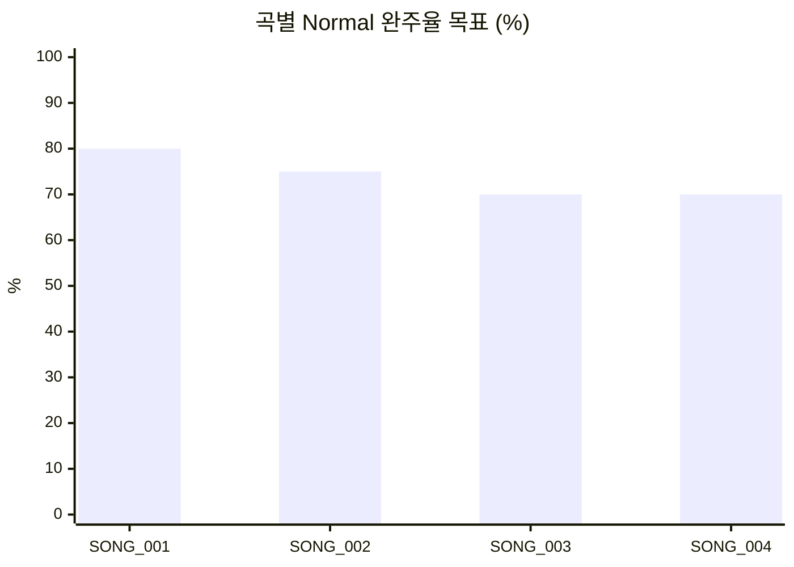

# 로그 · 지표 설계 — VR BeatSync

> 문서 세트: [목차](Proposal.md) · 기획: [컨셉](Concept.md) · [시스템](System.md) · [전투·개체](Combat_Entity.md) · [레벨 디자인](LevelDesign.md) · [밸런스](Balance.md) · 사업·운영: [사업 검토](Business.md) · [요구사항·로드맵](Requirements.md) · [Business Model](Monetization.md) · [서버·데이터](Server_Data.md) · [리소스](Resources.md) · **로그·지표** · [QA·출시](QA_Release.md) · [라이브 운영](LiveOps.md) · [사업화·법무](Business_Legal.md) · [needFix](needFix.md)

> **문서 정보** · 문서 번호 `D10-LOG` · 버전 v1.0 · 상태 `Draft` · 담당 기획자 · 클라이언트 개발자 · 최종 수정 2026-11-21 · 관련 문서 [사업 검토](Business.md) · [Business Model](Monetization.md)

**변경 이력**

| 버전 | 날짜 | 변경 내용 | 사유 | 결정자 | 영향 범위 |
|---|---|---|---|---|---|
| v1.0 | 2026-11-21 | 최초 작성 | — | 기획자 | — |

---

## 1. 목적
출시 후 **무엇을 측정할지** 정하는 문서예요.
> 지금 구현: 로그 없음. VR 스토어 · 헤드셋에서 쓸 수 있는 도구 선택 → [F-08](needFix.md#8-정할-것)

## 2. 이름 규칙
- 이벤트 `evt_대상_동작`, 파라미터 `snake_case`, 공통 `app_version` · `device_model` · `session_id`
- 개인정보 · 헤드셋 추적 원본 데이터(머리 · 손 위치 기록)는 넣지 않아요.

## 3. 이벤트 목록
| 이벤트 | 발생 시점 | 파라미터 | 확인할 지표 |
|---|---|---|---|
| `evt_session_start` | 앱 시작 | first_open, seated_mode | 세션 수 · 앉아서 모드 비율 |
| `evt_song_start` | 곡 시작 | song_id, difficulty | 인기 곡 · 난이도 |
| `evt_song_end` | 완주 · 실패 · 나가기 | song_id, difficulty, result(clear / fail / quit), score, rank, accuracy, max_combo, play_sec, fail_sec | 완주율 · 어디서 실패하는지 |
| `evt_judge_summary` | 곡 끝 1회 | perfect, marvelous, great, miss, miss_wrong_dir, miss_handle(손잡이 쪽 판정) | 판정 범위 문제 ([S-04](needFix.md) · [S-19](needFix.md)) |
| `evt_pause` | 일시정지 | reason(headset_off / menu) | 헤드셋 해제 빈도 ([S-07](needFix.md)) |
| `evt_calibrate` | 박자 보정 저장 | offset_ms | 기기별 지연 분포 ([S-16](needFix.md)) |
| `evt_unlock` | 난이도 해금 | song_id, difficulty | 해금율 |
| `evt_perf_drop` | 프레임이 목표 아래로 3초 이상 | song_id, sec | 성능 문제 구간 |

## 4. 지표 ↔ 이벤트
| 지표 | 계산 |
|---|---|
| 첫 곡 완주율 | 첫 `evt_song_end` 중 `result = clear` 비율 |
| 곡별 난이도 역전 | 같은 난이도에서 곡별 완주율 차이 — 차이가 크면 비트맵 조정 |
| 판정 불만 신호 | `miss_handle` 비율이 높으면 칼끝 판정([S-04](needFix.md)) 우선 |

**[막대그래프] 곡별 Normal 완주율 목표 (예시)**

