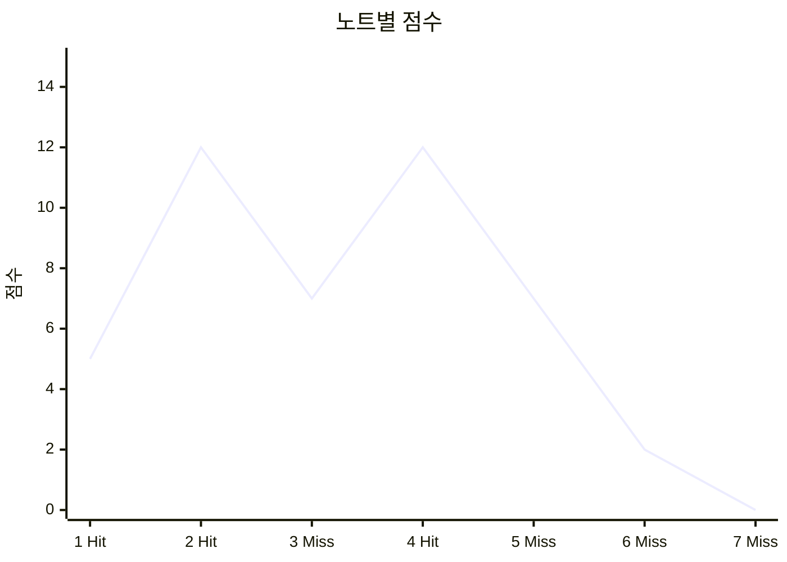
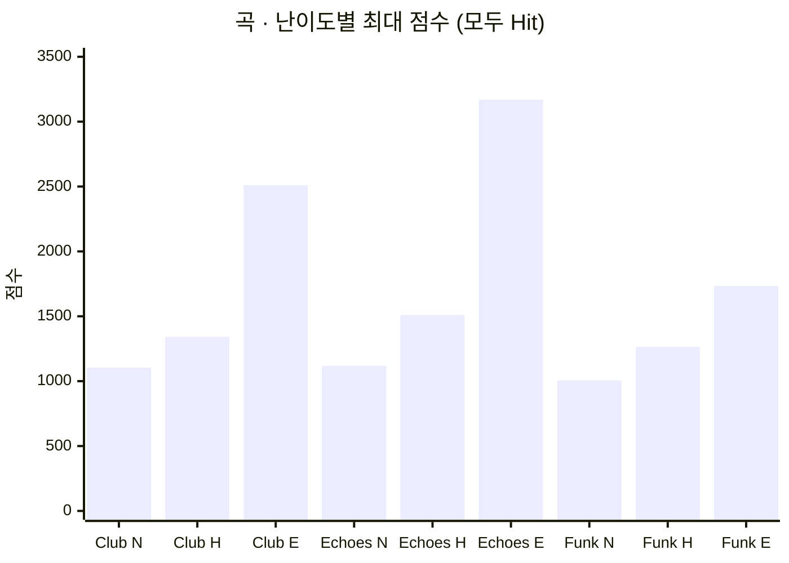

# 밸런스 · 데이터

> 문서 세트: [목차](Proposal.md) · [컨셉](Concept.md) · [시스템](System.md) · [베기·개체](Combat_Entity.md) · [레벨 디자인](LevelDesign.md) · **밸런스** · [needFix](needFix.md)
> 데이터 파일 (JSON · Unity `JsonUtility`로 바로 읽는 구조): [`score_rules.json`](Balance/score_rules.json) · [`beatmap_stats.json`](Balance/beatmap_stats.json)
> 값은 `vrTEST` 씬 · ScriptableObject · 비트맵 JSON 기준

---

## 1. 점수 규칙 (`score_rules.json`)
```
Hit  : 점수 += (COMBO ≥ 2 ? 7 : 5)
Miss : 점수 = max(0, 점수 - 5)            (씬 값 5, 코드 기본값 4)
레벨 : 점수가 200, 400, 800, 1600 … 에 닿을 때마다 +1 (점수가 내려가도 유지)
GAME OVER : Miss 직후 (점수 ≤ 0 OR 연속 Miss ≥ 3), 또는 노래 끝
```
**점수 변화 예시**
```
note       1    2    3    4    5    6    7
result     H    H    M    H    M    M    M
combo      1    2    0    1    0    0    0
miss run   0    0    1    0    1    2    3
score      5   12    7   12    7    2    0  -> GAME OVER (0점 · 연속 Miss 3번)

H = Hit (첫 +5 · 연속 +7) · M = Miss (-5)
```

**[선그래프] 점수 변화 예시 (위 표의 7개 노트)**

> 읽는 법: Hit이면 올라가고(첫 +5 · 연속 +7) Miss면 5씩 내려가요. 7번째에서 0점 · 연속 Miss 3번이 되어 GAME OVER예요.

## 2. 곡별 최대 점수 · 레벨 (`beatmap_stats.json`)
```
최대 점수(모두 Hit) = 5 + (노트 수 - 1) × 7
레벨 2(200점)까지 필요한 연속 Hit = 1 + 올림((200 - 5) ÷ 7) = 29개
```
| 곡 | 난이도 | 노트 | 최대 점수 | 도달 레벨 | 첫 2초(READY · GO!) 안의 노트 |
|---|---|---|---|---|---|
| Club Change Up | Normal | 158 | 1,104 | 4 | 4 |
| | Hard | 192 | 1,342 | 4 | 2 |
| | Expert | 359 | 2,511 | 5 | 4 |
| Echoes of Lumen | Normal | 160 | 1,118 | 4 | 0 |
| | Hard | 216 | 1,510 | 4 | 2 |
| | Expert | 453 | 3,169 | 5 | 3 |
| Upbeat Funk | Normal | 144 | 1,006 | 4 | 0 |
| | Hard | 181 | 1,265 | 4 | 1 |
| | Expert | 248 | 1,734 | 5 | 3 |

> 마지막 열은 카운트다운 2초 안에 있는 노트 수(건너뛰는 노트의 최소값)예요. 실제로는 이동 시간만큼 더 앞의 노트도 건너뛰어요.

**[막대그래프] 곡 · 난이도별 최대 점수 (모두 Hit)**

> 읽는 법: 모든 노트를 Hit했을 때의 점수예요.

## 3. GAME OVER 조건 계산
```
시작 직후 첫 노트 Miss → max(0, 0 - 5) = 0 → GAME OVER (Miss 직후 0점)
첫 Hit 1번 후 Miss     → 5 - 5 = 0       → GAME OVER
Hit 2번 후 Miss        → 12 - 5 = 7      → 계속
```
| 시작 상황 | 결과 |
|---|---|
| Miss | 즉시 GAME OVER |
| Hit → Miss | 즉시 GAME OVER |
| Hit → Hit → Miss | 7점, 계속 |
