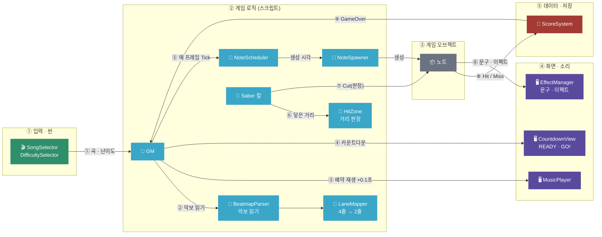
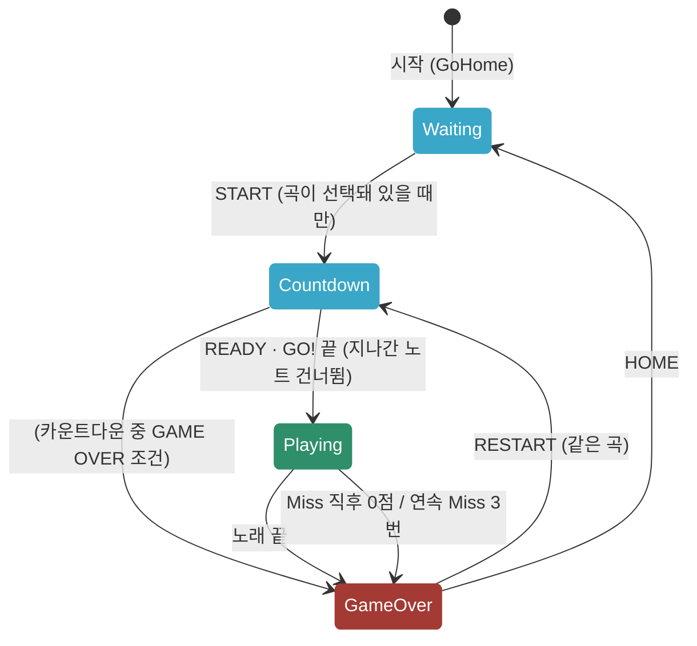
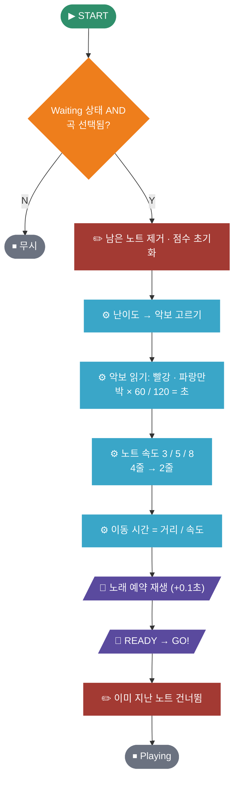
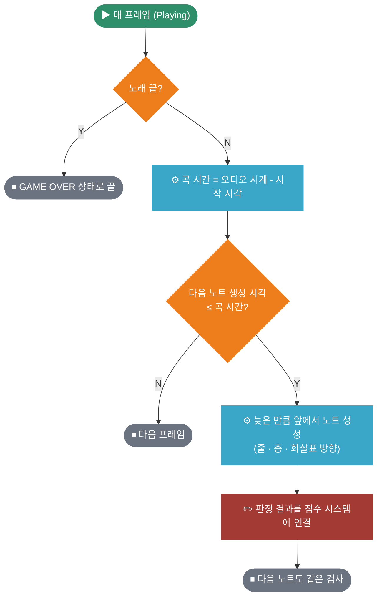
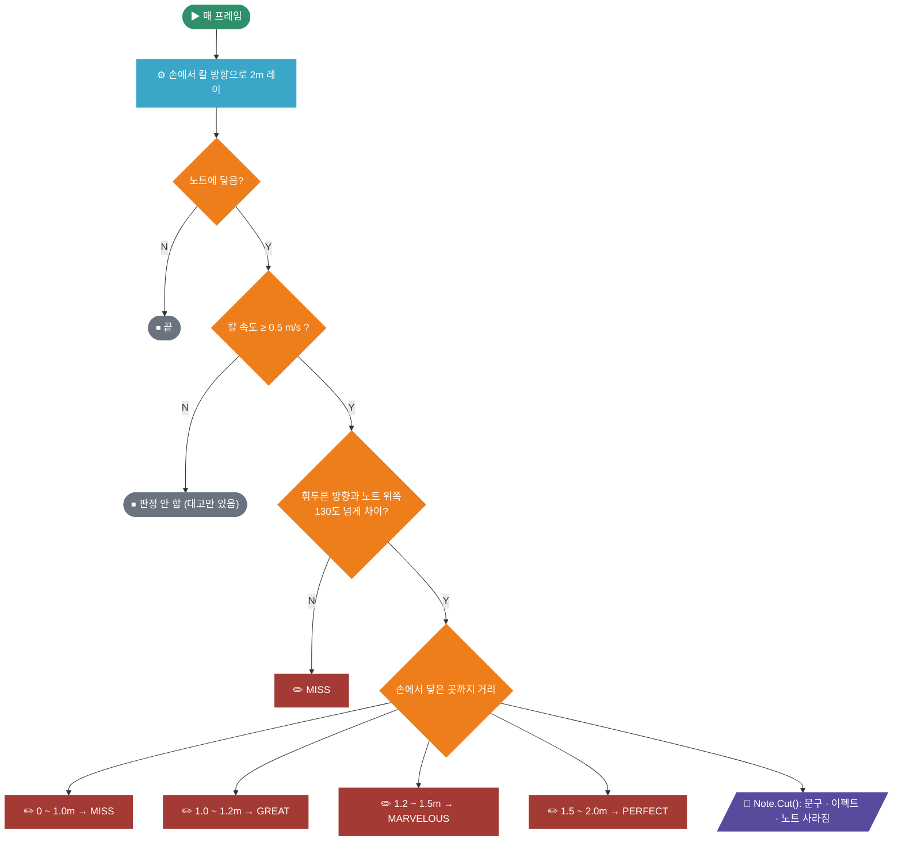
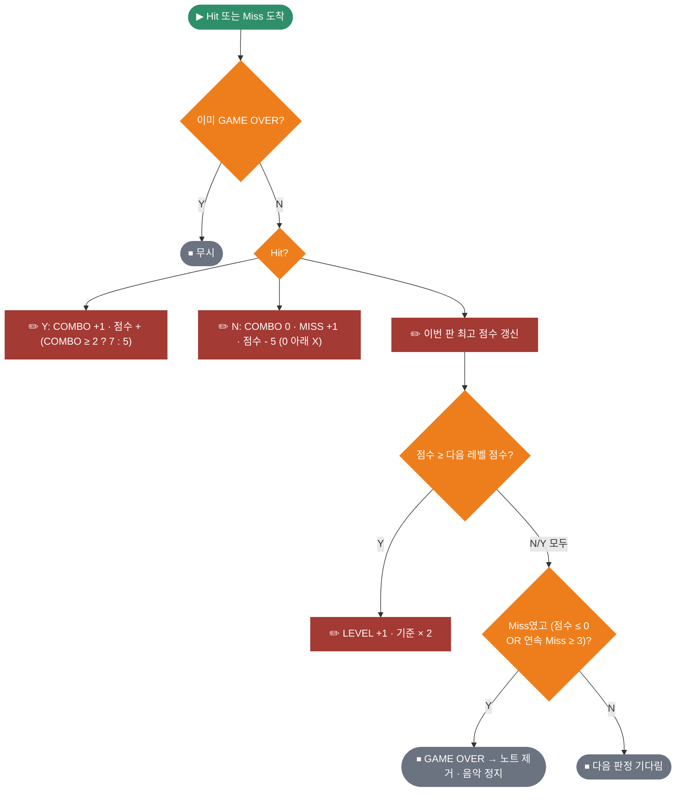
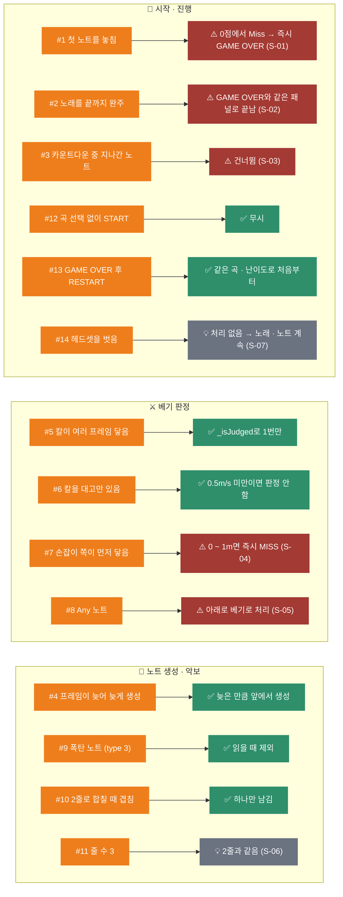

# 시스템 — 게임 흐름 · 노트 생성 · 판정 · 점수

> 문서 세트: [목차](Proposal.md) · 기획: [컨셉](Concept.md) · **시스템** · [전투·개체](Combat_Entity.md) · [레벨 디자인](LevelDesign.md) · [밸런스](Balance.md) · 사업·운영: [사업 검토](Business.md) · [요구사항·로드맵](Requirements.md) · [BM·경제](Monetization.md) · [서버·데이터](Server_Data.md) · [리소스](Resources.md) · [로그·지표](Analytics.md) · [QA·출시](QA_Release.md) · [라이브 운영](LiveOps.md) · [사업화·법무](Business_Legal.md) · [needFix](needFix.md)
> 관련 코드: `GM.cs` · `MusicPlayer.cs` · `BeatmapParser.cs` · `LaneMapper.cs` · `NoteScheduler.cs` · `NoteSpawner.cs` · `Note.cs` · `Saber.cs` · `HitZone.cs` · `ScoreSystem.cs` · `CountdownView.cs`

> **문서 정보** · ID `D03-SYSTEM` · v1.0 · 상태 `Review` · Owner ME (기획 · 개발) · 최종 수정 2026-11-21 · 관련 `D04-ENTITY`, `D07-BM`

**변경 이력**

| 버전 | 날짜 | 변경 내용 | 사유 | 결정자 | 영향 범위 |
|---|---|---|---|---|---|
| v0.9 | 2026-11-20 | 기존 문서 (자세한 기록은 git 커밋) | — | ME | — |
| v1.0 | 2026-11-21 | 문서 정보 · 변경 이력 · 문서 ID 추가, 문서 세트에 사업·운영 문서 연결 | 사내 문서 기준 v3 적용 | ME | 문서만 (게임 코드 · 데이터 변경 없음) |

---

## 0. 한눈에 보는 시스템 구조

**[구성도] 스크립트 연결**

> 읽는 법: 상자 = 씬 · 스크립트 · 오브젝트, 화살표 위 글 = 보내는 신호나 하는 일이에요. ①②③은 일어나는 순서예요.

## 1. 게임 상태 머신 (`GM`)

**[상태도] 게임 상태 머신 (GM)**

> 읽는 법: 상자 = 상태, 화살표 위 글 = 상태가 바뀌는 조건이에요. 검은 점에서 시작해요.

> `GameState.Result`와 3초 뒤 자동 홈 복귀 코드가 있지만, 지금은 어떤 경로로도 `Result`에 가지 않아요 → [S-02](needFix.md)

| 상태 | 음악 | 노트 | 화면에 있는 것 |
|---|---|---|---|
| Waiting | 정지 | 모두 제거 | 곡 `<` `>` · 난이도 · START |
| Countdown | 재생 시작 | 생성 안 함 | "READY" → "GO!" (1초씩) |
| Playing | 재생 | 악보 시간대로 생성 | SCORE · COMBO · MISS · LEVEL |
| GameOver | 정지 | 생성 중단 · 모두 제거 | 이번 판 최고 점수 · LEVEL · RESTART · HOME |

## 2. 작동 로직
### 2-1. 게임 시작 `PlayRoutine()`

**[흐름도] START를 눌렀을 때**

> 읽는 법: 초록에서 시작해 화살표를 따라 내려가요. 주황 마름모에서 Y(예) / N(아니오)으로 갈라져요.

> 세부 조건(코드 기준)은 [부록 A-1](#a-1-게임-시작-playroutine)에 있어요.

### 2-2. 노트 생성 `NoteScheduler.Tick()`

**[흐름도] 노트 생성 (매 프레임)**

> 읽는 법: 초록에서 시작해 화살표를 따라 내려가요. 주황 마름모에서 Y(예) / N(아니오)으로 갈라져요.

**음악과 노트를 맞추는 방법**
```
spawner                                         player
   [^] ------------- note speed --------------> P
   |<---------- distance (spawner -> P) -------->|

song time:  t - travel                           t
            ^ spawn                               ^ 노트가 플레이어에 닿음 = 음악 속 그 박자

travel = distance / speed   (Normal 3 · Hard 5 · Expert 8)
spawn  = note time - travel (오디오 시계 dspTime 기준)
```

> 세부 조건(코드 기준)은 [부록 A-2](#a-2-노트-생성-noteschedulertick)에 있어요.

### 2-3. 베기 판정 (`Saber` → `HitZone` → `Note`)

**[흐름도] 칼 하나 (매 프레임)**

> 읽는 법: 초록에서 시작해 화살표를 따라 내려가요. 주황 마름모에서 Y(예) / N(아니오)으로 갈라져요.

**방향 판정**
```
   ^  note up (transform.up = 화살표 반대쪽)
   |
   |    angle(swing, note up) > 130 deg  -> 방향 맞음
   |
   v  swing (= 화살표 방향)

화살표 방향(180도)으로 휘두르면 맞음 · 옆으로(90도)나 반대로 휘두르면 MISS
```

> 세부 조건(코드 기준)은 [부록 A-3](#a-3-베기-판정-saber--hitzone--note)에 있어요.

### 2-4. 점수 `ScoreSystem.Register()`

**[흐름도] 판정이 점수에 들어갈 때**

> 읽는 법: 초록에서 시작해 화살표를 따라 내려가요. 주황 마름모에서 Y(예) / N(아니오)으로 갈라져요.

> 세부 조건(코드 기준)은 [부록 A-4](#a-4-점수-scoresystemregister)에 있어요.

## 3. 예외 처리 (Edge Case) — 현재 동작
**[구성도] 예외 처리 지도**

> 읽는 법: 주황 = 이런 상황이면? → 초록 ✅ 코드가 이미 처리함 / 빨강 ⚠️ 문제 (괄호 = needFix 번호) / 회색 💡 고치면 좋은 점. 아래 표에 같은 번호로 자세히 있어요.

**[타임라인] 카운트다운 동안 건너뛰는 노트 (예외 #3)**

```mermaid
gantt
  title 카운트다운과 노트
  dateFormat x
  axisFormat %S초
  section 화면
  READY :r, 0, 1000ms
  GO! :g, 1000, 1000ms
  Playing :active, p, 2000, 2000ms
  section 노래
  재생 (START 직후부터) :active, m, 0, 4000ms
  section 노트 (예)
  건너뜀 :crit, milestone, s1, 400, 0ms
  건너뜀 :crit, milestone, s2, 1300, 0ms
  생성 :milestone, s3, 2600, 0ms
  생성 :milestone, s4, 3300, 0ms
```

> 읽는 법: 노래는 카운트다운과 함께 시작해서, 처음 2초 안에 생성될 노트는 건너뛰어요. 왼쪽 → 오른쪽이 시간이에요. 막대 = 이어지는 동안, 마름모 = 그 순간. 빨간 막대는 위험하거나 못 움직이는 시간이에요.

| # | 상황 | 현재 동작 | 상태 |
|---|---|---|---|
| 1 | 첫 노트를 놓침 | 0점에서 Miss → 점수 0 → 즉시 GAME OVER | ⚠️ → [S-01](needFix.md) |
| 2 | 노래를 끝까지 완주 | GAME OVER 상태 · 같은 패널로 끝남 | ⚠️ → [S-02](needFix.md) |
| 3 | 카운트다운 중 지나간 노트 | 건너뜀 | ⚠️ → [S-03](needFix.md) |
| 4 | 프레임이 늦어 노트가 늦게 생성 | 늦은 만큼 앞에서 생성 | ✅ |
| 5 | 한 노트에 칼이 여러 프레임 닿음 | `_isJudged`로 1번만 | ✅ |
| 6 | 칼을 노트에 대고만 있음 | 0.5m/s 미만이면 판정 안 함 | ✅ |
| 7 | 칼이 지나가며 손잡이 쪽이 먼저 닿음 | 처음 닿은 지점이 0 ~ 1m면 즉시 MISS | ⚠️ → [S-04](needFix.md) |
| 8 | "아무 방향(Any)" 노트 | 아래로 베기로 처리 | ⚠️ → [S-05](needFix.md) |
| 9 | 폭탄 노트(type 3) | 읽을 때 제외 | ✅ |
| 10 | 2줄로 합칠 때 같은 시간 · 줄 · 층에 겹침 | 하나만 남김 | ✅ |
| 11 | 줄 수 3 | `LaneMapper`가 4 미만이면 2줄로 → 3은 2와 같음 | → [S-06](needFix.md) |
| 12 | 곡을 선택하지 않고 START | 무시 | ✅ |
| 13 | GAME OVER 후 RESTART | 같은 곡 · 난이도로 처음부터, 점수 0 | ✅ |
| 14 | 헤드셋을 벗음 | 처리 없음 → 노래 · 노트 계속 | → [S-07](needFix.md) |

---

## 부록 A. 세부 조건 (코드 기준)
본문 흐름도의 조건을 코드 그대로 적은 개발 참고용이에요. 기획 내용은 본문에 있어요.

### A-1. 게임 시작 `PlayRoutine()`
```
START
├─ IF 상태 ≠ Waiting OR 곡 선택 안 됨 → 무시
└─ ELSE
    ├─ 남은 노트 제거 · 점수 초기화
    ├─ 난이도 → 악보 레벨(Normal / Hard / Expert) 선택 (없으면 Expert)
    ├─ 악보 JSON 읽기: 박(beat) × 60 ÷ BPM = 초, 빨강 · 파랑만(폭탄 제외), 시간순 정렬
    ├─ 노트 속도 = 난이도 속도, 줄 수 = 난이도 줄 수 → LaneMapper로 줄 합치기
    ├─ 이동 거리 = 생성 지점 → 플레이어 거리, 이동 시간 = 거리 ÷ 속도
    ├─ 음악 예약 재생 (지금 + 0.1초, 오디오 시계 기준)
    ├─ 카운트다운 (READY · GO! 각 1초)
    ├─ 카운트다운 동안 생성 시간이 지난 노트는 건너뜀
    └─ Playing
```

### A-2. 노트 생성 `NoteScheduler.Tick()`
```
매 프레임 (Playing)
├─ IF 노래 끝 → GAME OVER 상태로 종료
└─ 곡 시간 = 오디오 시계 - 시작 시각 + 보정값(0)
    └─ WHILE 다음 노트의 생성 시간(= 노트 시간 - 이동 시간) ≤ 곡 시간
        ├─ 늦은 만큼 앞에서 생성 (프레임 지연 보정: (곡 시간 - 생성 시간) × 속도)
        ├─ 위치 = 줄(가로 0.6m 간격) · 층(세로 0.5m 간격), 화살표 방향으로 회전
        └─ 판정 결과를 점수 시스템에 연결
```

### A-3. 베기 판정 (`Saber` → `HitZone` → `Note`)
```
매 프레임 (칼마다)
├─ 손 위치에서 칼 방향으로 2m 레이캐스트 (노트 레이어만)
├─ IF 노트에 닿음
│   ├─ 칼 속도 = 이번 프레임 이동 거리 ÷ 시간
│   ├─ IF 속도 < 0.5 m/s → 판정 안 함 (칼을 대고만 있음)
│   └─ ELSE
│       ├─ 방향 = 휘두른 방향과 노트 위쪽이 130도 넘게 차이 나는가
│       ├─ IF 방향 틀림 → MISS
│       └─ ELSE → 맞은 거리로 판정
│           ├─ 0 ~ 1.0m → MISS (손잡이 쪽)
│           ├─ 1.0 ~ 1.2m → GREAT
│           ├─ 1.2 ~ 1.5m → MARVELOUS
│           └─ 1.5 ~ 2.0m → PERFECT
│       └─ 노트.Cut(판정) → 한 번만 판정되고 사라짐
└─ 노트가 플레이어를 1m 지나도록 안 베임 → MISS
```

### A-4. 점수 `ScoreSystem.Register()`
```
IF 이미 GAME OVER → 무시
IF Hit  → COMBO +1, 연속 Miss 0, 점수 += (COMBO ≥ 2 ? 7 : 5)
IF Miss → COMBO 0, MISS +1, 연속 Miss +1, 점수 = max(0, 점수 - 5)
이번 판 최고 점수 갱신
WHILE 점수 ≥ 다음 레벨 점수 → LEVEL +1, 다음 레벨 점수 × 2 (200 → 400 → 800 …)
IF Miss AND (점수 ≤ 0 OR 연속 Miss ≥ 3) → GAME OVER 알림 → GM이 노트 제거 · 음악 정지
```
