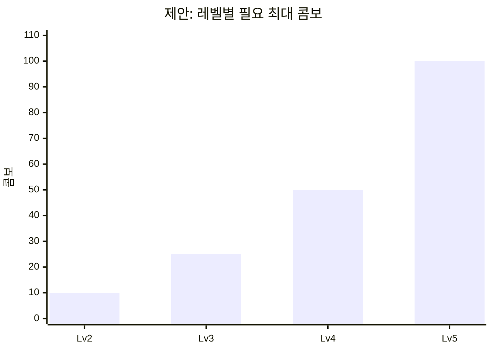
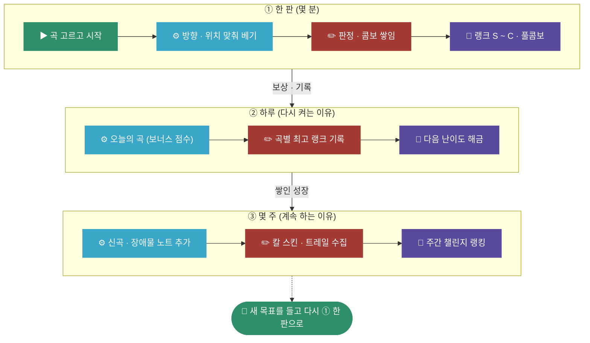

# needFix — 고칠 점 · 부족한 점 · 제안

> 문서 세트: [목차](common_Index.md) · 기획: [컨셉](planner_Concept.md) · [시스템](planner_System.md) · [전투·개체](planner_Combat_Entity.md) · [레벨 디자인](designer_LevelDesign.md) · [밸런스](planner_Balance.md) · 사업·운영: [사업 검토](owner_Business.md) · [요구사항·로드맵](planner_Requirements.md) · [Business Model](planner_Monetization.md) · [서버·데이터](developer_Server_Data.md) · [리소스](designer_Resources.md) · [로그·지표](planner_Analytics.md) · [QA·출시](tester_Release.md) · [라이브 운영](operator_LiveOps.md) · [사업화·법무](owner_Legal.md) · **needFix**
> 컨셉 ~ 밸런스 문서는 현재 구현만 담고, 변경 제안은 모두 이 문서에서 관리. 반영 시 항목 상태 **완료** 변경 및 컨셉 ~ 밸런스 문서 값 수정 필요 (담당: 기획자). 사업 · 운영 문서(계획 · 초안)에서 나온 **정할 것**은 8절에 있음.

> **문서 정보**

| 문서 번호 | 버전 | 상태 | 책임자 | 협업 | 최종 수정 | 관련 문서 |
|---|---|---|---|---|---|---|
| `D00-FIX` | v1.3 | `Review` | 기획자 | 전 직무 (항목별 담당 칸 참고) | 2026-11-23 | — |

**변경 이력**

| 버전 | 날짜 | 변경 내용 | 사유 | 결정자 | 영향 범위 |
|---|---|---|---|---|---|

---

## 1. 버그 · 코드와 의도가 다른 부분
| ID | 현재 (코드 근거) | 문제 | 제안 | 관련 | 상태 |
|---|---|---|---|---|---|
| S-01 | 첫 노트 Miss 또는 Hit 1번 뒤 Miss → 0점 → GAME OVER | 시작하자마자 끝날 수 있음 | 첫 Hit 전에는 0점 조건 제외, 또는 시작 점수 부여 | 시스템 §3 #1 · 밸런스 §3 | 결정 필요 |
| S-02 | 노래가 끝나면 `Finish(GameState.GameOver)` | 완주와 실패가 같은 패널 | 노래 끝 → `Result` 상태 ("CLEAR!" + 결과, 이미 있는 3초 자동 복귀 활용) | 시스템 §1 | 대기 |
| S-03 | 카운트다운 동안 생성 시간이 지난 노트 건너뜀 | 곡 앞부분 노트가 사라짐 | 카운트다운이 끝난 뒤 노래 재생, 또는 첫 노트 앞에 여유 시간 | 시스템 §3 #3 | 대기 |
| S-04 | 레이가 처음 닿은 지점으로 즉시 판정 | 칼끝으로 벨 생각이었어도 손잡이 쪽이 먼저 닿으면 MISS | 한 번 휘두르는 동안 가장 먼 거리를 기준으로 판정 | 시스템 §3 #7 | 대기 |
| S-05 | Any 방향을 아래(0)로 처리 | Any 노트를 다른 방향으로 베면 MISS | Any는 방향 검사 생략 | 시스템 §3 #8 | 대기 |
| S-06 | `LaneMapper`: 4 미만이면 2줄 | `_laneCount` 3이 2와 같음 | 3줄 매핑 추가 또는 범위를 2 / 4로 | 시스템 §3 #11 | 대기 |
| S-07 | 헤드셋 해제 처리 없음 | 벗어도 노래 · 노트 계속 | 일시정지 + 노래 일시정지 (오디오 시계 보정 필요) | 시스템 §3 #14 | 대기 |

**[타임라인] 카운트다운과 노래 시작: 현재 vs 제안**

```mermaid
gantt
  title 노래 시작 시점
  dateFormat x
  axisFormat %S초
  section 현재
  카운트다운 :c1, 0, 2000ms
  노래 :active, m1, 0, 6000ms
  section 제안
  카운트다운 :c2, 0, 2000ms
  노래 :active, m2, 2000, 6000ms
```


## 2. 밸런스 · 부족한 기능 제안
### S-08 판정별 점수 차등

현재 PERFECT · MARVELOUS · GREAT 모두 같은 점수.

| 판정 | 현재 (첫 / 연속) | 제안 (첫 / 연속) |
|---|---|---|
| PERFECT | 5 / 7 | 7 / 10 |
| MARVELOUS | 5 / 7 | 5 / 7 |
| GREAT | 5 / 7 | 3 / 5 |

```
최대 점수(모두 PERFECT) = 7 + (노트 수 - 1) × 10
Club Change Up Expert = 7 + 358 × 10 = 3,587 (현재 2,511)
```

### S-09 레벨 기준을 최대 콤보로

**[막대그래프] 제안: 레벨별 필요 최대 콤보**


현재 레벨 2까지 29연속 Hit, 점수는 Miss로 내려가서 기준이 흔들림.

| 레벨 | 현재 (점수) | 제안 (최대 콤보) |
|---|---|---|
| 2 | 200 | 10 |
| 3 | 400 | 25 |
| 4 | 800 | 50 |
| 5 | 1,600 | 100 |

```
max combo  0        10        25            50                    100
           |--Lv1---|---Lv2---|-----Lv3-----|--------Lv4---------|--> Lv5
```

### S-10 난이도 기준표 (곡과 상관없이 같은 느낌)
현재 Echoes of Lumen Hard(1.35개/초)가 Club Change Up Normal(2.62개/초)보다 쉬움 (레벨 디자인 §3).

| 난이도 | 목표 밀도 | 노트 속도 | 줄 수 | 방향 | 폭탄 |
|---|---|---|---|---|---|
| Normal | 1.0 ~ 2.0개/초 | 3 | 2 | 상하좌우 4방향 | 없음 |
| Hard | 2.0 ~ 3.5개/초 | 5 | 2 | 8방향 | 있음 |
| Expert | 3.5 ~ 6.0개/초 | 8 | 4 (원본 그대로) | 8방향 | 있음 |

```
notes/s   0    1    2    3    3.5  4    5    6
          |----|----|----|----|----|----|----|
Normal         [=========]                        1.0 ~ 2.0
Hard                [==============]              2.0 ~ 3.5
Expert                        [=============]     3.5 ~ 6.0
```
| 조정 방법 | 대상 예 |
|---|---|
| 기준보다 밀도가 높으면 한 단계 낮은 악보 사용 | Club Change Up Normal |
| 기준보다 밀도가 낮으면 한 단계 높은 악보 사용 | Echoes of Lumen Hard |
| 곡 선택 화면에 밀도 표시 | 전체 |

### S-11 장애물 노트
```
OBS_BOMB (베면 Miss)        OBS_WALL (몸으로 피하기)
      .--.                     ##########
     ( ** )                    ##########      <- 머리를 숙이거나
      '--'                     ##########         옆으로 비켜서 피함
```
- 폭탄은 비트맵에 이미 있는 type 3을 그대로 활용

### S-12 콤보 연출
콤보 10 · 50 · 100에서 칼 트레일 색 · 굵기 변화 + 짧은 효과음, GAME OVER 때 노래 감속 연출.

## 3. 확인 · 결정이 필요한 항목
| ID | 내용 | 필요한 것 |
|---|---|---|
| S-13 | VR 화면 · 메뉴 배치 | VR 화면 캡처를 컨셉에 추가 |
| S-14 | 한 줄 소개 · 타깃 유저 · 레퍼런스 게임 | 기획자가 정해서 컨셉에 추가 (README의 "한 줄 소개: 직접 작성" 칸) |
| S-15 | 생성 지점 → 플레이어 거리 (노트 이동 시간) | 씬에서 거리 확인 → 밸런스 §2의 건너뛰는 노트 수를 정확히 계산 |
| S-16 | 기기별 박자 지연 | 실제 헤드셋에서 `_timingOffset` 보정값 측정 |

---

## 4. 실무에서 쓸 때 아쉬운 점
위 1 ~ 3절은 게임 내용, 이 절은 **문서를 실무 팀(개발 · 아트 · QA · 사업)과 함께 쓸 때** 부족한 점임. **상태** 칸은 반영 여부임.

| 아쉬운 점 | 왜 문제인가 | 제안 | 상태 |
|---|---|---|---|
| 문서 정보 · 변경 이력이 없음 | 팀원마다 다른 버전을 보고 이야기하게 됨 | 문서 맨 위에 작성자 · 버전 · 날짜 · 변경 내용 표 | ✅ 반영 — 모든 문서 맨 위 문서 정보 · 변경 이력 |
| 기획 의도(왜)가 없음 | 구현 설명서로 읽혀서, 수치를 바꿀 때 판단 기준이 없음 | 각 시스템 첫머리에 "의도 1 ~ 2줄 → 규칙 → 예외" 순서 | ✅ 반영 — [컨셉](planner_Concept.md) 기획 의도 (시스템 첫머리 의도는 문서마다 다시 확인) |
| UI 와이어프레임 · 맵 도면이 없음 | UI · 아트 · 레벨 담당이 위치와 크기를 알 수 없음 | Figma 와이어프레임, 씬 탑다운 캡처에 번호 표시 | ✅ 반영 — 시스템 · 레벨 문서의 [와이어프레임] · [도면] |
| 리소스 목록(ID)이 없음 | 아트 · 사운드 발주와 진행 확인이 어려움 | `FX_` · `SFX_` · `UI_` ID와 담당 · 상태가 있는 표 | ✅ 반영 — [리소스](designer_Resources.md) (라이선스 확인은 F-03) |
| 예외 처리가 테스트 케이스로 이어지지 않음 | QA 측 재정리 작업 발생 | 예외 처리 표에 "확인 방법 · 기대 결과" 칸 추가 → 그대로 QA 체크리스트 | ✅ 반영 — [QA · 출시](tester_Release.md) §3 테스트 케이스 |
| 확인 · 결정 항목에 담당 · 기한이 없음 | 결정 주체 · 기한 부재로 "대기" 장기화 | 3절 표에 담당 · 기한 칸 추가 | ✅ 반영 — 8절 표에 담당 · 기한 칸 |
| 데이터 원본 형식 (예전 지적: CSV만 있음) | 기획 문서와 엔진이 다른 값을 볼 수 있음 | **JSON을 원본**으로 (결정됨), 검증 규칙(JSON Schema)으로 범위 검사 | ✅ JSON 전환 완료 · 검증 규칙은 F-04 |
| 성공 기준(KPI)이 없음 | 고친 뒤 좋아졌는지 판단할 숫자가 없음 | 한 판 평균 시간 · 재시작률 · D1 / D7 재접속률 목표를 먼저 정하기 | ✅ 반영 — [사업 검토](owner_Business.md) §4 · [로그](planner_Analytics.md) (목표값은 가정) |
| 곡 · 악보 라이선스 정보가 없음 | 출시 · 외부 공개 시 저작권 확인 필요 | 곡별 출처 · 라이선스 · 사용 범위 표 | 🔶 일부 — [리소스](designer_Resources.md) §2 곡 · 악보 표, 원문 확인은 F-03 |
| VR 편의 · 안전 기준이 없음 | 헤드셋 해제 처리 없음 (S-07), 박자 지연 보정 미측정 (S-16) | 보정 화면 · 휴식 안내 · 플레이 공간 기준 정하기 | ✅ 반영 — [QA · 출시](tester_Release.md) §4 VR 편의 · 안전 기준 (수치 확정은 F-09) |
| 결정 로그 (가이드 0-5) 없음 | 결정 이유가 흩어져 사라짐 | 결정 로그 문서 | ✅ 반영 — [결정 로그](common_Decisions.md) |
| 용어집 (가이드 0-6) 없음 | 같은 것을 다른 말로 부름 | 용어집 문서 | ✅ 반영 — [용어집](common_Glossary.md) |
| 단계별 Gate 체크리스트 (P0 → 출시) | 사업 검토에 P0 → P1만 있었음 | 전체 단계 Gate | ✅ 작성 — [목차](common_Index.md) 맨 아래 · ❌ P0 → P1부터 미통과 |

## 5. 기획 · 흐름 평가와 방향

**잘된 점**

- 오디오 시계(dspTime) 기준 예약 재생으로 **박자가 정확**함.
- 방향(130도) + 칼 위치(3단계) 판정으로 "어떻게 베었나"가 드러남.
- 비트맵을 읽어 곡을 늘리기 쉬운 구조임.

**아쉬운 점** (근거 = 이 문서 세트의 수치)

| 아쉬운 점 | 근거 | 플레이어가 느끼는 것 |
|---|---|---|
| 첫 노트를 놓치면 바로 GAME OVER | 0점에서 Miss → GAME OVER (S-01) | 처음 하는 사람은 시작하자마자 끝남 — 가장 큰 이탈 지점 |
| 완주해도 GAME OVER 화면 | 노래 끝 = `GameState.GameOver` (S-02) | 성공했는데 실패한 느낌 |
| 판정 3단계가 점수에 반영 안 됨 | Hit이면 등급과 상관없이 +5 / +7 (S-08) | 정확하게 벨 이유가 없음 |
| 레벨 기준이 점수 2배씩 | 200 · 400 · 800 … (밸런스 §1) | 뒤로 갈수록 레벨이 거의 안 오름 |

**한 판 흐름 평가**

- 곡 · 난이도 선택 → READY · GO → 플레이 흐름이 리듬 게임 표준에 맞음.
- 실패 조건이 너무 빨라(S-01) **배우는 구간**이 없음. 체력 게이지형(Miss마다 감소, Hit마다 회복)이 리듬 게임 실무에서 흔한 방식임.
- 완주 결과 화면(랭크 · 판정 개수 · 최대 콤보)이 있어야 다시 도전할 목표가 생김.

**방향 제시** — 우선순위 순서

| 순서 | 방향 | 관련 제안 |
|---|---|---|
| 1 | 실패 조건을 체력 게이지로 | S-01 |
| 2 | 완주 결과 화면 · 랭크 (S · A · B · C) | S-02 |
| 3 | 판정별 점수 차등 (PERFECT가 가장 높게) | S-08 |
| 4 | 난이도 기준표로 곡마다 같은 느낌 | S-10 |

## 6. 계속 플레이하게 만드는 성장 설계 (제안)
리듬 게임은 **곡 × 난이도 × 랭크** 조합이 그대로 장기 목표가 됨. 지금 구조(비트맵 읽기)는 곡을 늘리기 쉬워서 이 방향에 잘 맞음.

**[구성도] 재방문 루프 (제안)**


| 단계 | 장치 | 플레이어에게 주는 이유 | 만드는 데 필요한 것 |
|---|---|---|---|
| ① 한 판 | 완주 랭크 · 풀콤보 표시, 콤보 연출 | "한 번만 더 하면 S" | S-02 · S-12 |
| ② 하루 | 오늘의 곡, 곡별 최고 랭크 기록, 랭크 A 이상이면 다음 난이도 해금 | 짧은 목표 · 실력이 느는 체감 | 기록 저장 · 해금 표 |
| ③ 몇 주 | 정기 신곡 추가, 장애물 노트로 새 패턴 | 새로운 것이 계속 옴 | S-11 · 곡 라이선스 (4절) |
| ③ 몇 주 | 랭크를 모아 칼 스킨 · 트레일 해금, 주간 챌린지 랭킹 | 수집 · 경쟁 | 스킨 리소스 · 리더보드 |

**확인할 숫자 (KPI)**

- 첫 판 완주율 (S-01 개선 전후 비교)
- 곡별 재도전 횟수 · 평균 랭크
- 세션 길이 (VR 피로 기준) · D7 재접속률

## 7. 최종 방향 · 실행 계획
> 위 1 ~ 6절을 바탕으로, 이 게임이 가장 잘될 방향과 무엇부터 할지 정리한 최종 계획임.

**최종 방향**
**첫 곡부터 끝까지 완주하며 박자 · 베기 손맛을 쌓고, 랭크(S ~ C) 갱신으로 다시 도전하는 직관적인 VR 리듬 게임**. 시작하자마자 끝나는 경험 대신 완주 몰입감과 랭크 도전이 중심임.

**정리된 결정**

| 항목 | 위 절의 내용 | 최종 결정 | 이유 |
|---|---|---|---|
| S-08 판정별 점수 | PERFECT 7 / 10 · MARVELOUS 5 / 7 · GREAT 3 / 5 | 차등 방향은 유지, 수치는 **랭크(S · A · B · C) 기준선과 함께** 플레이 테스트로 확정 | 곡마다 노트 수 · 길이가 다름 |
| S-09 레벨 기준 | 최대 콤보 10 → 25 → 50 → 100 | 콤보 하나만 쓰지 말고 **정확도 · 완주를 함께** 보기, 초 · 중반 기준을 완만하게 | 콤보는 한 번 실수하면 0이라 초 · 중반 유저에게 가파름 |
| S-10 난이도 기준표 | 초당 노트 수 1 ~ 6개 | 틀은 유지, **노트 속도(3 / 5 / 8)와 반응 시간은 실제 헤드셋으로 검증** | 거리 · 시야각에 따라 체감이 크게 다름 |
| 6절 리텐션 | 정기 신곡 · 칼 스킨 · 주간 챌린지 랭킹 | **보류**. 첫 판 완주율 개선 + 곡별 최고 랭크 저장 + 다음 난이도 해금만 | 곡 라이선스 · 리소스 비용이 큼 |

**추가 제안**

| ID | 내용 | 근거 |
|---|---|---|
| S-17 | 체력 게이지 수치: 시작값 · Miss 감소 폭 · Hit 회복 폭을 정하기 | S-01(즉시 GAME OVER)과 S-02(완주 결과)를 자연스럽게 잇는 핵심 수치임 |
| S-18 | 노트 도달 시간 · 박자 보정 기준: "보이는 타이밍과 베는 타이밍의 오차"를 실제 헤드셋에서 재는 방법 | 리듬 게임의 생명 (S-15 · S-16 확장, 생성 지점까지 약 13.8m — 레벨 디자인 §1 도면) |
| S-19 | 판정 범위 검증: 칼끝 거리 판정(S-04) · Any 방향(S-05) 적용 후 빠른 연타 구간에서 뜻밖의 Miss가 없는지 테스트 | 판정이 바뀌면 체감 일관성부터 확인 필요 |

**실행 우선순위** (1인 개발 · 짧은 기간)

| 순서 | 할 일 | 관련 제안 |
|---|---|---|
| 1 | 치명적 흐름 버그 (첫 Miss 즉시 GAME OVER · 완주 결과 화면 분리 · 카운트다운 노트 · 헤드셋 해제) | S-01 · S-02 · S-03 · S-07 · S-17 |
| 2 | 판정 · 줄 · 난이도 기준 정리로 곡 사이 난이도 역전 줄이기 | S-04 · S-05 · S-06 · S-08 · S-10 · S-19 |
| 3 | 콤보 연출 + 곡별 최고 랭크 저장 | S-12 · S-09(간소화) |

## 8. 정할 것
> 결정 시 항목 상태 **완료** 변경 및 관련 문서 상태 `Draft` → `Review` 변경 필요 (담당: 항목별 담당 · 관련 문서 책임자).

| ID | 내용 | 왜 필요한가 | 관련 문서 | 담당 | 기한 | 상태 |
|---|---|---|---|---|---|---|
| F-01 | 1차 VR 스토어 결정 (Meta Horizon Store · Android XR 등) | 심사 기준 · 수수료 · 빌드 설정이 달라짐 | [사업 검토](owner_Business.md) | 대표 (협업: 기획자) | 알파 전 | 대기 |
| F-02 | 노트 · 칼 · 무대의 독자 디자인 방향 | 대표작과 겉모습이 비슷하면 심사 · 분쟁 위험 | [사업 검토](owner_Business.md) §3 | 대표 (협업: 기획자) | 베타 전 | 대기 |
| F-03 | **곡 4개 · Beat Sage 악보의 상업 이용 확인**, 안 되면 곡 교체 · 구매 · 의뢰, 악보 직접 제작 | 곡이 상품 → 라이선스 문제면 출시 불가 | [리소스](designer_Resources.md) §2 · [사업화 · 법무](owner_Legal.md) | 아트 디자이너 (승인: 대표) | 베타 전 | ⚠️ 대기 |
| F-04 | 가격 (₩9,900 ~ ₩14,900) · 무료 데모 여부 | 경쟁작 가격 · 곡 수 · 분량 기준 | [Business Model](planner_Monetization.md) §3 | 기획자 (승인: 대표) | 출시 준비 전 | 대기 |
| F-05 | 곡 ID 체계 (`SONG_###`)를 폴더 · ScriptableObject · 기록에 통일 | 곡 추가 · 곡 팩 · 로그가 같은 ID를 써야 함 | [서버 · 데이터](developer_Server_Data.md) §4 | 서버 개발자 | 베타 | 대기 |
| F-06 | 게임 정식 이름 (VR BeatSync는 가칭) · 상표 검색 | 흔한 이름이라 겹칠 수 있음 | [사업화 · 법무](owner_Legal.md) | 대표 | 알파 후 | 대기 |
| F-07 | `Video/video 1.mp4` (meta만 있음) 등 빈 · 안 쓰는 에셋 정리 | 빌드 경고 · 라이선스 점검 범위 | [리소스](designer_Resources.md) §3 | 클라이언트 개발자 | 베타 | 대기 |
| F-08 | 분석 도구 선택 (VR에서 동작하는 것) | [REQ_111](planner_Requirements.md) 시작 조건 | [로그 · 지표](planner_Analytics.md) | 기획자 (협업: 클라이언트 개발자) | 베타 전 | 대기 |
| F-09 | VR 편의 · 안전 기준 수치 확정 (주사율 · 앉아서 모드 · 번쩍임) | 스토어 심사 · 멀미 리뷰 | [QA · 출시](tester_Release.md) §4 | QA 테스터 (협업: 클라이언트 개발자) | 베타 | 대기 |
| F-10 | JSON 검증 규칙(JSON Schema) — `Balance/schema/*.schema.json`, 비트맵 JSON 형식 검사 | 잘못된 악보 · 수치를 빌드 전에 잡기 | [밸런스](planner_Balance.md) | 클라이언트 개발자 | 베타 전 | 대기 |
| F-11 | 저장 방식 (JSON 파일 하나) 확정 | 곡이 늘어날 때 기록 관리 | [서버 · 데이터](developer_Server_Data.md) §3 | 서버 개발자 | 베타 | 대기 |
| F-12 | 사업자 형태 · 등록 시점 (다른 게임 · 서비스와 같은 사업자로 갈지) | 스토어 판매자 계정 · 정산 | [사업화 · 법무](owner_Legal.md) | 대표 | 출시 준비 전 | 대기 |
| F-13 | 출시 목표일 | 일정 기준 | [사업 검토](owner_Business.md) §6 | 대표 (협업: 기획자) | 알파 후 | 대기 |

## 9. 문서 표준화 점검
> 2026-11-23 기업 문서 기준 점검 결과. 문서 이름 · 담당 · 문체는 반영 완료, 아래는 **실제 프로젝트 구조와 대조해 부족한 부분**. 처리 시 상태 **완료** 변경 필요.

| ID | 현재 (근거) | 문제 | 조치 | 담당 | 기한 | 상태 |
|---|---|---|---|---|---|---|
| N-01 | 문서 번호 `D01-CONCEPT` · `D01-BIZ` 동일 번호 사용 | 번호만으로 문서 특정 불가 | 번호 재부여 또는 "번호 = 단계, 이름 = 구분" 규칙 명시 결정 필요 | 기획자 (승인: 대표) | 알파 전 | 대기 |
| N-02 | [요구사항](planner_Requirements.md) 담당 칸 초안 배정, Given / When / Then 완료 기준은 Must 일부만 작성 | 단계별 Gate P1 → P2 조건(모든 Must에 담당 · 공수 · 완료 기준) 미충족 | 담당 확정 및 나머지 Must 완료 기준 작성 필요 | 기획자 (협업: 클라이언트 개발자) | 알파 전 | 대기 |
| N-03 | 문서 정보 표의 책임자는 직무 기준, 실제 인원 배정 기록 없음 | 1인 개발 시 모든 직무가 동일인 → 승인 · 검토 분리 불가 | 직무별 실제 담당자(겸직 포함) · 검토자를 [결정 로그](common_Decisions.md)에 기록 필요 | 대표 | 알파 전 | 대기 |
| N-04 | `Assets/cs/` 자체 스크립트 중 문서 미기재: `Interfaces/I*.cs` 13개, `Note/` (`NoteData` · `NoteResult` · `HitGrade` · `CutDirection` · `NoteColor`), `UI/` (`GameOverView` · `ScoreView` · `SettingsView` · `ListSelector` 등), `Manager/` (`GameStateActivator` · `SoundController` · `SoundManager`), `Song/SongData` · `Difficulty/BeatmapLevel` | 시스템 문서가 실제 구조 일부만 설명 | [시스템](planner_System.md)에 인터페이스 · 데이터 · UI 구성도 추가 필요 | 기획자 (협업: 클라이언트 개발자) | 알파 전 | 대기 |
| N-05 | `VRTemplateAssets/Scripts/*` (Unity VR 템플릿 14개) — 사용 여부 문서 미기재 | 출시 빌드 포함 범위 불명 | 사용 스크립트 확인 후 [리소스](designer_Resources.md) 표기, 미사용은 제거 필요 | 클라이언트 개발자 | 베타 전 | 대기 |
