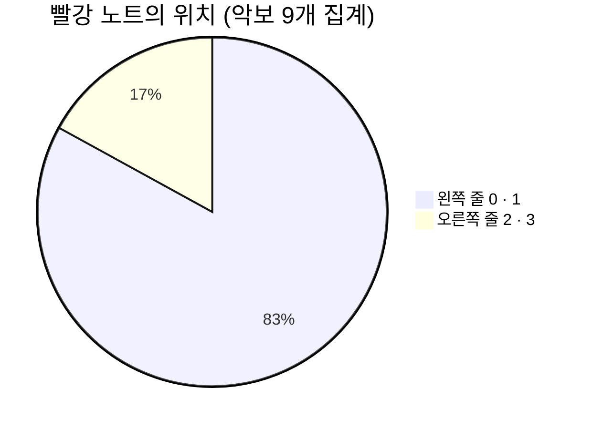
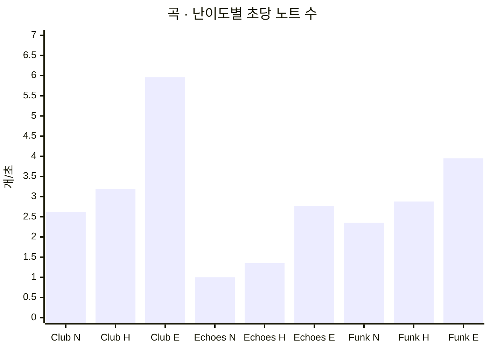

# 레벨 디자인 — 노트 배치 · 곡 · 난이도

> 문서 세트: [목차](common_Index.md) · 기획: [컨셉](planner_Concept.md) · [시스템](planner_System.md) · [전투·개체](planner_Combat_Entity.md) · **레벨 디자인** · [밸런스](planner_Balance.md) · 사업·운영: [사업 검토](owner_Business.md) · [요구사항·로드맵](planner_Requirements.md) · [Business Model](planner_Monetization.md) · [서버·데이터](developer_Server_Data.md) · [리소스](designer_Resources.md) · [로그·지표](planner_Analytics.md) · [QA·출시](tester_Release.md) · [라이브 운영](operator_LiveOps.md) · [사업화·법무](owner_Legal.md) · [needFix](common_needFix.md)
> 데이터: [`Balance/beatmap_stats.json`](planner_Balance/beatmap_stats.json) — 비트맵 JSON 9개를 읽어 계산

> **문서 정보**

| 문서 번호 | 버전 | 상태 | 책임자 | 협업 | 최종 수정 | 관련 문서 |
|---|---|---|---|---|---|---|
| `D05-LEVEL` | v1.1 | `Review` | 레벨 디자이너 | 밸런스 기획자 | 2026-11-23 | [밸런스](planner_Balance.md) |

**변경 이력**

| 버전 | 날짜 | 변경 내용 | 사유 | 결정자 | 영향 범위 |
|---|---|---|---|---|---|

---

## 1. 구성
리듬 게임의 "레벨" = 곡 × 난이도 악보.

| 항목 | 내용 | 근거 |
|---|---|---|
| 악보 | Beat Sage로 만든 `.dat` → `.json` | `Sounds/BeatSaga/` |
| 곡 | Club Change Up · Echoes of Lumen · Upbeat Funk (모두 BPM 120) | `SongsData/*.asset` |
| 난이도 | 곡마다 악보 3개 + 노트 속도 3 / 5 / 8 + 줄 2개 | `DifficultyData/*.asset` |

**[도면] vrTEST 씬 — 플레이어 · 노트 생성 지점 (위에서 본 모습)**
```
z 14.7
  ........................................................
  .........................C..............................
  .........................3..............................
  ........................................................
  ........................................................
  ........................................................
  ........................................................
  ........................................................
  .........................2..............................
  ........................................................
  ........................................................
  ........................................................
  .........................1..............................
  ........................................................
  ........................................................
  ........................................................
  ..............................P.........................
  ........................................................
z -2.3   x -1 ~ 1.2  (오른쪽 = +x, 위 = +z)
```

| 표시 | 무엇 | 씬 이름 | 월드 좌표 (x, z) |
|---|---|---|---|
| P | 플레이어 (XR Origin) | `XR Origin (XR Rig)` | 0.2, -0.9 |
| N | 노트 생성 지점 | `NoteSpawner` | 0, 12.9 |
| 1 | 바닥 표시 1 | `Plane (3)` | 0, 2.6 |
| 2 | 바닥 표시 2 | `Plane (2)` | 0, 7 |
| 3 | 바닥 표시 3 | `Plane (1)` | 0, 13.2 |
| C | 메뉴 캔버스 (월드 공간) | `Canvas` | 0, 13.3 |

노트 생성 지점은 플레이어(XR Origin 바닥 기준) 앞 약 **13.8m**임. 난이도별 노트 속도로 나누면 이동 시간은 Normal 4.6초 · Hard 2.8초 · Expert 1.7초임 (머리 위치 · 칼 길이는 빼고 계산, [S-15](common_needFix.md) 참고).

## 2. 노트 배치 그리드
원본 악보는 가로 4줄 × 세로 3층. 게임에서는 `LaneMapper`가 가로 4줄을 2줄로 합치고(0 · 1 → 왼쪽, 2 · 3 → 오른쪽), 같은 시간 · 줄 · 층에 겹치는 노트는 하나만 남김.

```
원본 (4 × 3)                    현재 (2 × 3)
층2  □ □ □ □                   층2   □   □
층1  □ □ □ □      ──합침──▶    층1   □   □
층0  □ □ □ □                   층0   □   □
     0 1 2 3                         L   R
```
| 집계 (악보 9개 전체) | 값 |
|---|---|
| 빨강 노트 중 왼쪽(줄 0 · 1) | 83% |
| 파랑 노트 중 오른쪽(줄 2 · 3) | 81% |

**[원그래프] 빨강 노트의 위치 (악보 9개 집계)**


## 3. 곡 · 난이도별 노트 밀도
| 곡 | 마지막 노트 시각 | Normal (속도 3) | Hard (속도 5) | Expert (속도 8) |
|---|---|---|---|---|
| Club Change Up | 약 61초 | 158개 · 2.62개/초 | 192개 · 3.19개/초 | 359개 · 5.96개/초 |
| Echoes of Lumen | 약 164초 | 160개 · 1.00개/초 | 216개 · 1.35개/초 | 453개 · 2.77개/초 |
| Upbeat Funk | 약 64초 | 144개 · 2.35개/초 | 181개 · 2.88개/초 | 248개 · 3.95개/초 |

- 같은 난이도라도 곡마다 밀도가 다름: Echoes of Lumen Hard(1.35) < Club Change Up Normal(2.62)
- 세 난이도 모두 줄 2개 (`_laneCount` 범위는 2 ~ 4)

> 난이도 기준 정리는 [S-10](common_needFix.md)

**[막대그래프] 곡 · 난이도별 초당 노트 수**


