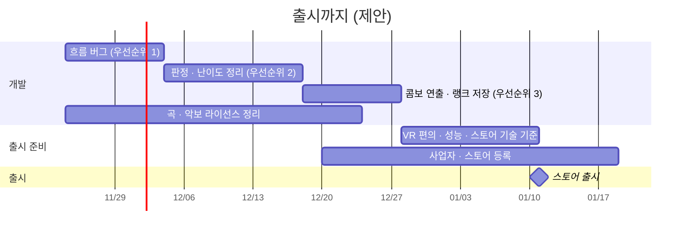

# 사업 검토 — VR BeatSync

> 문서 세트: [목차](common_Index.md) · 기획: [컨셉](planning_Concept.md) · [시스템](planning_System.md) · [전투·개체](planning_Combat_Entity.md) · [레벨 디자인](planning_LevelDesign.md) · [밸런스](planning_Balance.md) · 사업·운영: **사업 검토** · [요구사항·로드맵](planning_Requirements.md) · [Business Model](planning_Monetization.md) · [서버·데이터](dev_Server_Data.md) · [리소스](design_Resources.md) · [로그·지표](planning_Analytics.md) · [QA·출시](qa_QA_Release.md) · [라이브 운영](ops_LiveOps.md) · [사업화·법무](owner_Business_Legal.md) · [needFix](common_needFix.md)

> **문서 정보** · 문서 번호 `D01-BIZ` · 버전 v1.0 · 상태 `Draft` · 담당 대표 · 기획자 · 최종 수정 2026-11-21 · 관련 문서 [컨셉](planning_Concept.md) · [Business Model](planning_Monetization.md) · [사업화·법무](owner_Business_Legal.md)

**변경 이력**

| 버전 | 날짜 | 변경 내용 | 사유 | 결정자 | 영향 범위 |
|---|---|---|---|---|---|
| v1.0 | 2026-11-21 | 최초 작성 | — | 대표 | — |

---

## 1. 목적
이 게임을 **출시까지 만들 가치가 있는지** 판단하는 문서예요. 사업계획서 · 정부지원사업 신청서의 원본으로도 써요. 숫자는 **목표 · 가정**이에요.

## 2. 한 장 요약
| 항목 | 내용 | 상태 |
|---|---|---|
| 게임 이름 | VR BeatSync (가칭) | 상표 확인 필요 |
| 한 줄 정의 | 음악 박자에 맞춰 날아오는 노트를 화살표 방향으로 베는 VR 리듬 게임 | 확정 ([컨셉](planning_Concept.md)) |
| 최종 방향 | 첫 곡부터 **완주**하며 손맛을 쌓고 랭크(S ~ C) 갱신으로 재도전 | needFix §7 결정 |
| 플랫폼 | 6DoF VR 헤드셋 — `meta-openxr` · `androidxr-openxr` 패키지 → **Meta Quest · Android XR** | 1차 스토어 결정 → [F-01](common_needFix.md#8-정할-것) |
| 타깃 | 리듬 게임을 좋아하는 VR 사용자 | 확정 |
| 수익 모델 | **유료 앱(프리미엄)** + 나중에 곡 팩 추가 판매 → [Business Model](planning_Monetization.md) | 제안 |

## 3. 경쟁작 비교
| 유형 | 보통의 Business Model | 이 게임의 차별점 |
|---|---|---|
| VR 리듬 장르 대표작 (Beat Saber) | 유료 앱 + 곡 팩 DLC | **칼의 어느 부분에 맞았는지까지 보는 3단계 판정** |
| VR 피트니스 리듬 | 구독 | 운동이 아니라 판정 손맛 · 랭크 |
| 무료 VR 리듬 데모 | 무료 · 광고 없음 | 곡 추가가 쉬운 구조 (비트맵 JSON) |

> 대표작과 **겉모습이 너무 비슷하면** 스토어 심사 · 저작권 분쟁 위험이 있어요. 노트 · 칼 · 무대 디자인은 독자적으로 → [F-02](common_needFix.md#8-정할-것)

## 4. 목표 지표 (KPI) — 가정
| 지표 | 목표 (예시값) | 확인 방법 |
|---|---|---|
| 첫 곡 완주율 | 70% | [로그](planning_Analytics.md) `evt_song_end.result` |
| 한 세션 곡 수 | 4곡 | `evt_song_start` |
| 환불률 (유료 앱) | 5% 미만 | 스토어 콘솔 |
| 멀미 · 불편 리뷰 | 리뷰의 5% 미만 | 스토어 리뷰 |
| 다음 난이도 해금율 | 50% | `evt_unlock` |

## 5. 개략 예산 (1인 개발)
| 항목 | 내용 |
|---|---|
| 인건비 | 1인 (기획 · 개발 겸임) |
| 기기 | 테스트용 헤드셋 (Quest 계열 1대 이상) |
| **음원** | 지금 곡은 무료 음원 사이트 · AI 악보 생성(Beat Sage) → **상업 이용 확인 · 필요하면 곡 구매 · 작곡 의뢰** |
| 스토어 | Meta Horizon Store 등록 · 심사 (조건 확인) |
| 서버 | 없음 |

## 6. 개략 일정
**[타임라인] 출시까지 (제안)**

## 7. 리스크와 대응
| 리스크 | 영향 | 대응 |
|---|---|---|
| **곡 · 악보 라이선스** | 상업 출시 불가 · 삭제 요청 | [리소스](design_Resources.md) §2, 원문 확인 · 필요 시 곡 교체 ([F-03](common_needFix.md)) |
| 첫 노트 Miss로 즉시 GAME OVER ([S-01](common_needFix.md)) | 첫인상 최악 · 환불 | 우선순위 1 |
| 박자 지연 · 멀미 | VR 리뷰는 편의성에 민감 | 박자 보정([S-16](common_needFix.md)) · 편의 기준 ([QA](qa_QA_Release.md) §4) |
| VR 스토어 심사 | 기술 기준(성능 · 안전) 미달 시 거절 | 심사 기준을 QA 항목으로 미리 넣기 |
| 대표작과 비슷한 외형 | 분쟁 위험 | 독자 디자인 ([F-02](common_needFix.md)) |

## 8. 결정 (Gate P0 → P1)
- [ ] 1차 스토어 ([F-01](common_needFix.md)) · 곡 확보 방법 ([F-03](common_needFix.md)) · 출시 목표일 ([F-13](common_needFix.md))
