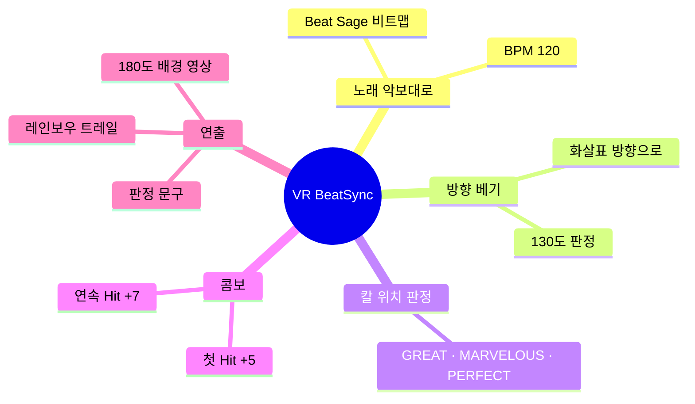
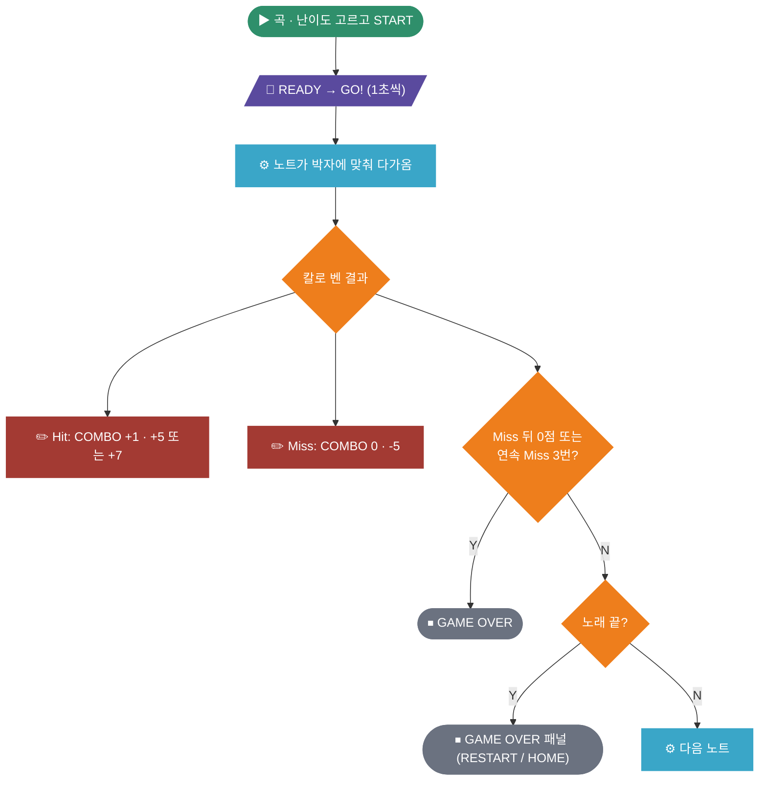

# 게임 컨셉 — VR BeatSync

> 문서 세트: [목차](common_Index.md) · 기획: **컨셉** · [시스템](planner_System.md) · [전투·개체](planner_Combat_Entity.md) · [레벨 디자인](designer_LevelDesign.md) · [밸런스](planner_Balance.md) · 사업·운영: [사업 검토](owner_Business.md) · [요구사항·로드맵](planner_Requirements.md) · [Business Model](planner_Monetization.md) · [서버·데이터](developer_Server_Data.md) · [리소스](designer_Resources.md) · [로그·지표](planner_Analytics.md) · [QA·출시](tester_Release.md) · [라이브 운영](operator_LiveOps.md) · [사업화·법무](owner_Legal.md) · [needFix](common_needFix.md)

> **문서 정보**

| 문서 번호 | 버전 | 상태 | 책임자 | 협업 | 최종 수정 | 관련 문서 |
|---|---|---|---|---|---|---|
| `D01-CONCEPT` | v1.1 | `Review` | 기획자 | — | 2026-11-23 | [사업 검토](owner_Business.md) · [요구사항·로드맵](planner_Requirements.md) |

**변경 이력**

| 버전 | 날짜 | 변경 내용 | 사유 | 결정자 | 영향 범위 |
|---|---|---|---|---|---|

---

## 기획 의도
> 기획자가 정한 방향임. 아래 "개요"부터는 지금 코드 · 씬에 구현된 내용임.

| 항목 | 내용 |
|---|---|
| 한 줄 정의 | 음악 박자에 맞춰 날아오는 노트를 화살표 방향으로 베는 VR 리듬 게임 |
| 기획 의도 (핵심 재미) | 방향을 맞춰 칼끝으로 벨수록 좋은 판정(PERFECT) → "제대로 벤다"는 손맛과 박자 몰입 |
| 타깃 | 리듬 게임을 좋아하는 VR 사용자 |
| 플랫폼 · 제약 | VR 헤드셋 + 컨트롤러 2개, 기기별 박자 지연 보정 필요, 곡 라이선스 확인 필요 |
| 레퍼런스 · 차별점 | VR 리듬 장르 대표작(Beat Saber) → **칼의 어느 부분에 맞았는지까지 보는 3단계 판정**, 비트맵을 읽어 곡 추가가 쉬움 |

## 개요
| 항목 | 내용 | 근거 |
|---|---|---|
| 장르 | VR 리듬 액션 (양손 칼로 노트 베기) | `Saber`, `Note` |
| 플랫폼 | 6DoF VR 헤드셋 | XR Interaction Toolkit |
| 엔진 | Unity 6 (6000.6.3f1) · C# · URP | `ProjectSettings` |
| 씬 | `vrTEST` | 빌드 설정 |
| 수록곡 | Club Change Up · Echoes of Lumen · Upbeat Funk (모두 BPM 120) | `SongsData/*.asset` |
| 난이도 | Normal · Hard · Expert | `DifficultyData/*.asset` |
| 악보 | Beat Sage로 만든 `.dat`를 `.json`으로 바꿔 사용 | `Sounds/BeatSaga/` |

## 재미 요소 (코드에서 확인되는 것)
| 요소 | 내용 | 근거 |
|---|---|---|
| 노래 악보대로 | 노트가 비트맵 시간에 맞춰 옴 | `BeatmapParser`, `NoteScheduler` |
| 방향 베기 | 화살표 방향으로 휘둘러야 잘림 (130도 판정) | `Saber` |
| 칼 위치 판정 | 칼의 어느 부분에 맞았는지로 GREAT / MARVELOUS / PERFECT | `HitZone` |
| 콤보 | 첫 Hit +5, 연속 Hit +7 | `ScoreSystem` |
| 연출 | 레인보우 칼 트레일 · 판정 문구 · 180도 배경 영상 | `RainbowTrailFollower`, `EffectManager`, README |

**노트 모양 (정면에서 본 모습)**
```
red / Up     blue / Right    red / DownLeft    any
+-------+    +-------+       +-------+         +-------+
|   ^   |    |       |       |     / |         |       |
|   |   |    |  -->  |       |    /  |         |   o   |
|   |   |    |       |       |   v   |         |       |
+-------+    +-------+       +-------+         +-------+

빨강 = 왼손 칼 · 파랑 = 오른손 칼 · 화살표 = 휘둘러야 하는 방향 · any = 코드에서 아래 방향으로 처리
```

**한 노트를 베는 순간**
```
  note [ v ]     <- 화살표가 아래를 가리키는 노트
         |
         | swing
         v         <- 화살표 방향(아래)으로 휘두르기

1) 칼 끝 쪽(1.5 ~ 2.0m)에 맞힘     -> PERFECT
2) 방향이 맞음 (130도 넘게 차이)    -> Hit
3) COMBO가 이어짐                   -> +7점
```

**[마인드맵] 재미 요소 한눈에**


## 코어 루프

**[흐름도] 코어 루프**


## VR 구성
| 항목 | 내용 | 근거 |
|---|---|---|
| 칼 | 왼손 빨강 · 오른손 파랑, 길이 2m | `Saber`, `HitZone` |
| 노트 자리 | 2줄 × 3층 (가로 0.6m · 세로 0.5m 간격) | `NoteSpawner`, `LaneMapper` |
| 플레이어 이동 | 없음 (노트가 다가옴) | `Note` 이동 |
| 박자 동기화 | 오디오 시계(dspTime) 기준 예약 재생 +0.1초 | `MusicPlayer` |

```
              spawner
               [^] [>]          <- 2줄 x 3층 자리에 노트 생성
                 |  다가옴 (Normal 3 · Hard 5 · Expert 8 m/s)
                 v
      SCORE · COMBO · MISS · LEVEL
           L-saber   R-saber      <- 길이 2m
                  P
```

## 개발 현황
| 구분 | 내용 |
|---|---|
| 구현됨 | 비트맵 파싱 · 시간 맞춤 노트 생성 · 음악 예약 재생 · 카운트다운 · 칼 판정 3단계 · 방향 판정 · 점수 · 콤보 · 레벨 · GAME OVER 3조건 · 곡 / 난이도 선택 · 연출 |
| 구조 | 인터페이스 13개로 역할 분리, `InterfaceReference`로 인스펙터에서 연결 |
| 다음 할 일 | [needFix](common_needFix.md) |
