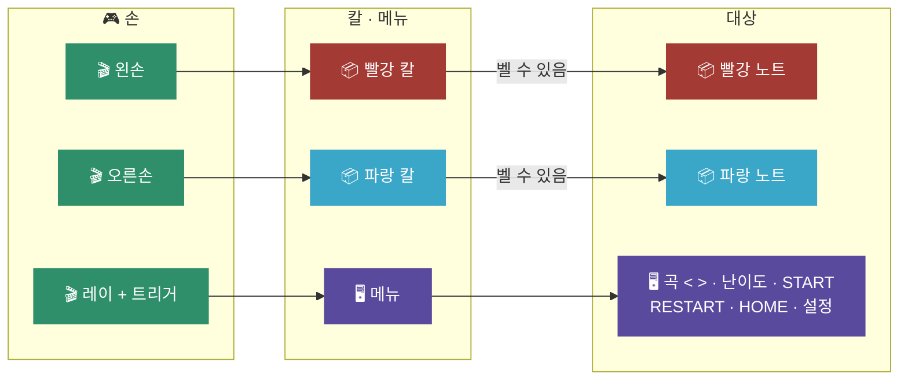
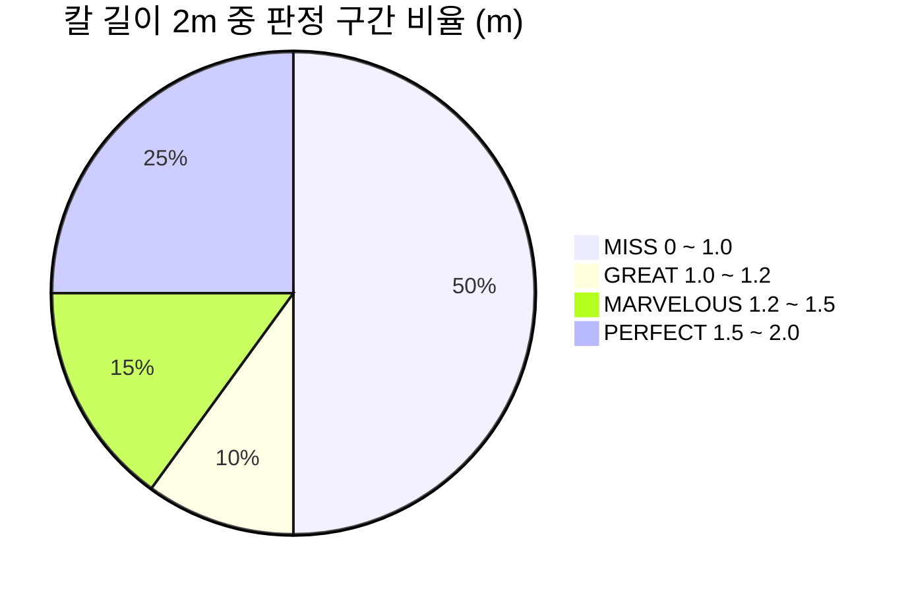
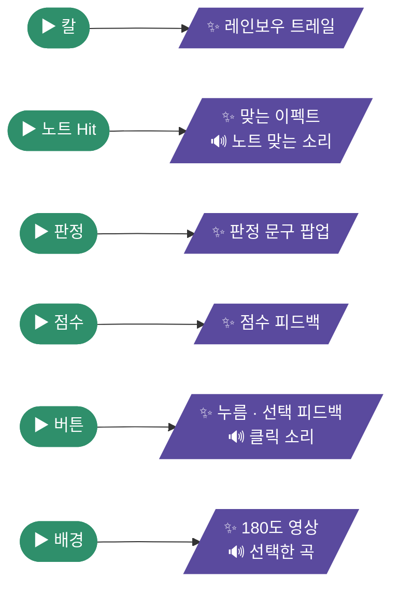

# 베기 · 개체 (칼 · 노트 · 판정 연출)

> 문서 세트: [목차](../Proposal.md) · 기획: [컨셉](Concept.md) · [시스템](System.md) · **전투·개체** · [레벨 디자인](LevelDesign.md) · [밸런스](Balance.md) · 사업·운영: [사업 검토](../대표/Business.md) · [요구사항·로드맵](Requirements.md) · [Business Model](Monetization.md) · [서버·데이터](../개발/Server_Data.md) · [리소스](../디자인/Resources.md) · [로그·지표](Analytics.md) · [QA·출시](../QA/QA_Release.md) · [라이브 운영](../운영/LiveOps.md) · [사업화·법무](../대표/Business_Legal.md) · [needFix](../needFix.md)
> 리듬 게임이라 "전투" 자리에 핵심 조작(베기)과 상호작용 개체(칼 · 노트)를 담았어요. 값은 `vrTEST` 씬 · ScriptableObject 기준.

> **문서 정보** · 문서 번호 `D04-ENTITY` · 버전 v1.0 · 상태 `Review` · 담당 기획자 · 아티스트 · 최종 수정 2026-11-21 · 관련 문서 [밸런스](Balance.md) · [리소스](../디자인/Resources.md)

**변경 이력**

| 버전 | 날짜 | 변경 내용 | 사유 | 결정자 | 영향 범위 |
|---|---|---|---|---|---|
| v0.9 | 2026-11-20 | 기존 문서 (자세한 기록은 git 커밋) | — | 기획자 | — |
| v1.0 | 2026-11-21 | 문서 정보 · 변경 이력 · 문서 번호 추가, 사업 · 운영 문서와 연결 | — | 기획자 | 문서만 |

---

## 1. VR 조작
| 손 | 칼 색 | 벨 수 있는 노트 |
|---|---|---|
| 왼손 | 빨강 | 빨강 노트 |
| 오른손 | 파랑 | 파랑 노트 |
| 메뉴 | 레이 + 트리거 | 곡 `<` `>` · 난이도 · START · RESTART · HOME · 설정 |

| 항목 | 내용 | 근거 |
|---|---|---|
| 플레이어 이동 | 없음, 노트가 다가옴 | `Note` 이동 |
| 박자 동기화 | 오디오 시계 기준 예약 재생 (+0.1초), 보정값 `_timingOffset` = 0 | `MusicPlayer`, `GM` |

**[구성도] VR 조작 (손 → 칼 → 벨 수 있는 노트)**


## 2. 칼 (`Saber` · `HitZone`)
**칼 판정 구간 (실제 길이 비율)**
```
hand                                                         tip
[=]==========================|=====|=======|==================>
0m                          1.0   1.2     1.5                2.0m
|<---------- MISS --------->|GREAT|MARVEL.|<---- PERFECT ---->|

레이캐스트가 처음 닿은 지점까지의 거리로 판정 · 칼을 0.5 m/s보다 느리게 대고만 있으면 판정 안 함
```
| 항목 | 값 |
|---|---|
| 길이 | 2.0m (레이캐스트) |
| 최소 휘두르기 속도 | 0.5 m/s |
| 방향 판정 | 휘두른 방향과 노트 위쪽 사이 각도 130도 초과 |
| 연출 | 레인보우 트레일 (`RainbowTrailFollower`) |

| 구간 | 판정 | 결과 |
|---|---|---|
| 0 ~ 1.0m | MISS | Miss |
| 1.0 ~ 1.2m | GREAT | Hit |
| 1.2 ~ 1.5m | MARVELOUS | Hit |
| 1.5 ~ 2.0m | PERFECT | Hit |

**[원그래프] 칼 길이 2m 중 판정 구간 비율 (m)**


## 3. 노트 (`Note` · `NoteSpawner`)
**노트 자리 (플레이어가 정면으로 본 모습, 2줄)**
```
layer 2    [ ]      [ ]      y = -0.39 + 2 x 0.5 =  0.61m
layer 1    [ ]      [ ]      y = -0.39 + 1 x 0.5 =  0.11m
layer 0    [ ]      [ ]      y = -0.39
            L        R

줄 간격 0.6m · 층 간격 0.5m (원본 악보 4줄을 2줄로 합침)
```
**8방향 + any (노트 회전 각도)**
```
UpLeft 135     Up 180     UpRight -135
        \        |        /
Left 90  ------ note ------  Right -90
        /        |        \
DownLeft 45    Down 0     DownRight -45

any = 아래 방향(0)으로 처리
```
| 항목 | 값 |
|---|---|
| 색 | 빨강(type 0) · 파랑(type 1) — 폭탄(3)은 읽을 때 제외 |
| 방향 | 8방향 + Any |
| 속도 | Normal 3 · Hard 5 · Expert 8 m/s (`DifficultyData`) |
| 놓침 | 플레이어를 1m 지나면 MISS (`GM._missMargin`) |
| 판정 후 | 한 번만 판정 → 사라짐 (Hit이면 맞는 이펙트) |

## 4. 판정 문구 · 피드백
| 문구 | 조건 | 점수 |
|---|---|---|
| `PERFECT` | 칼 1.5 ~ 2.0m | 첫 +5 / 연속 +7 |
| `MARVELOUS` | 1.2 ~ 1.5m | 첫 +5 / 연속 +7 |
| `GREAT` | 1.0 ~ 1.2m | 첫 +5 / 연속 +7 |
| `MISS` | 손잡이 쪽 · 방향 틀림 · 놓침 | -5 |
| `READY` · `GO!` | 시작 | – (1초씩) |

| 연출 값 (`EffectManager`) | 값 |
|---|---|
| 판정 문구 크기 · 표시 시간 · 떠오르는 높이 | 3 · 0.6초 · 0.3 |
| 맞는 이펙트 유지 | 2초 |

## 5. 이펙트 · 사운드
**[흐름도] 이펙트 · 사운드 (일이 생기면 → 보이고 들리는 것)**


| 대상 | 이펙트 | 사운드 |
|---|---|---|
| 칼 | 레인보우 트레일 | – |
| 노트 Hit | 맞는 이펙트 (`EffectManager.PlayHit`) | 노트 맞는 소리 |
| 판정 | 판정 문구 팝업 (`GradePopup`) | – |
| 점수 | 점수 피드백 (`ScoreFeedback`) | – |
| 버튼 | 누름 · 선택 피드백 | 클릭 소리 |
| 배경 | 180도 영상 (README) | 선택한 곡 |
